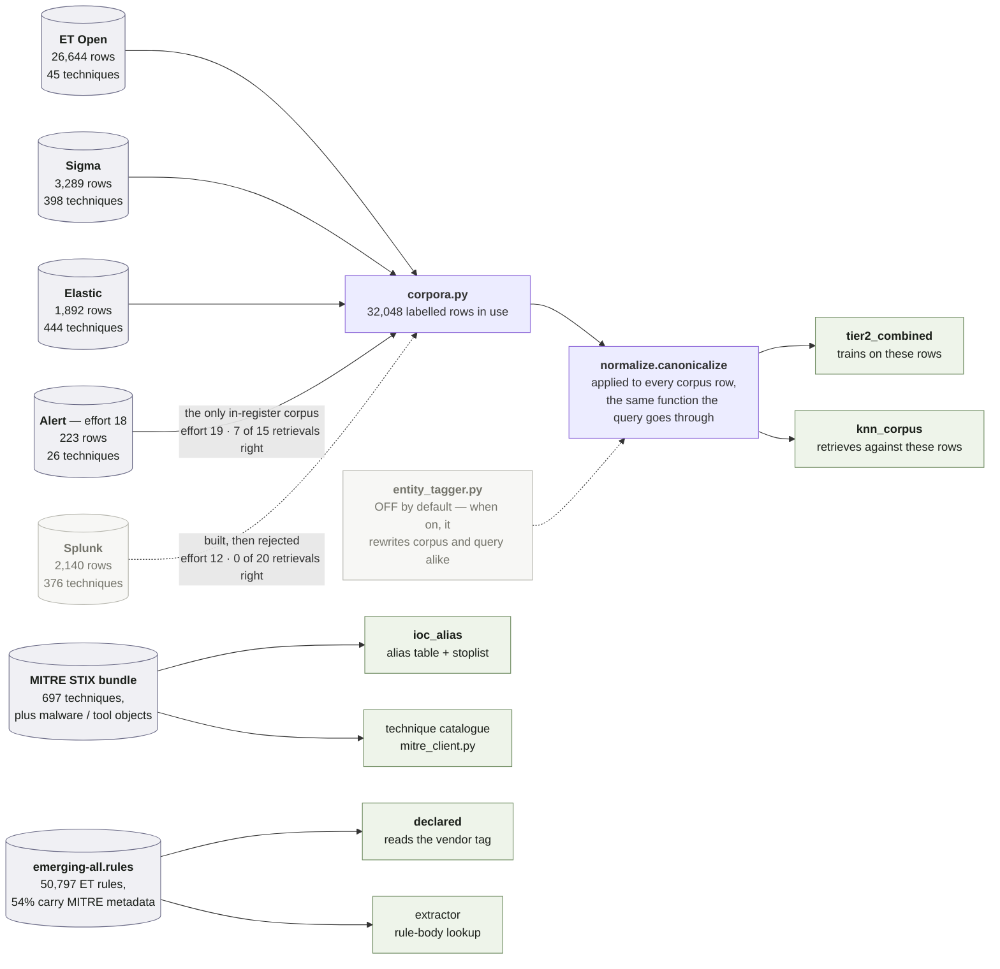

# Mapping IDS signatures to MITRE ATT&CK: consolidated research report

Branch `research/b2-mitre-eval`. Standalone research spike under
`experiments/mitre_mapping/` — does not touch SAGE's production pipeline.

**This file is the canonical reference for this line of work.** It consolidates
fourteen sub-experiments previously recorded across `STATUS.md`, `findings.md`,
six per-experiment `findings.md` files, two design documents and two label-queue
documents. Those files remain on disk as the underlying records and are cited by
path throughout; this report is what to read first, and what to write the paper
from.

---

## 0. How to read this report

**If you are new to this work**, read §1 (what problem this solves) and §2
(vocabulary — every term and component name used later is defined there), then §3
(how anything here is measured). Those three sections make the rest legible.

**If you are writing the paper**, §2 and §3 give you the methodology section, §4
the data section, §5 the experiments, §6 the discussion, and §11 every number
ever measured.

**If you are picking the work back up**, read §6.1 (the current explanation of
why everything stalls), §7 (what the pipeline looks like today) and §8 (what is
left to try).

### Figures

Two diagrams carry most of the structural explanation, and both are rendered
inline by GitHub and by any Markdown preview with Mermaid support:

- **Figure 1** (§2.5) — the pipeline end to end: what happens to one signature,
  which source answers it, and what makes a row fall through to the next one.
- **Figure 2** (§7.1) — where each source's knowledge comes from: the seven
  artifacts behind the pipeline (six external, plus effort 19's alert corpus
  built from this repo's own data), and which resolver each one feeds.

### How experiments are referred to

Nineteen sub-experiments ran, numbered **1–19 in the order they happened**. §5
describes each in full; every other section cites them shorthand, as "effort 10".
Where a section says something was removed or added "in effort N", that is a
pointer forward or back to §5, not a term you need to know yet.

### One rule that governs every number below

Five different evaluation sets were used over this branch's history, and four
separate measurement corrections landed between them. **A number measured on one
set cannot be compared to a number measured on another.** Every result in this
report is therefore tagged with a regime letter, A–E, defined in §3.2. When you
see "40.2% (regime D)", the letter is not decoration — it is the only thing that
makes the number mean anything.

This matters because the branch's headline fell from 53.8% to 32.7% over its
history, and **none of that fall was a regression.** It was inflation being
removed. Ranking the numbers into a single column reproduces exactly the error
that took efforts 9–14 to unwind.

### Contents

| § | |
|---|---|
| 1 | [Problem statement](#1-problem-statement) |
| 2 | [Background and vocabulary](#2-background-and-vocabulary) |
| 3 | [How results are measured](#3-how-results-are-measured) |
| 4 | [Data](#4-data) |
| 5 | [Approaches tried](#5-approaches-tried) |
| 6 | [Cross-cutting findings](#6-cross-cutting-findings) |
| 7 | [Current architecture](#7-current-architecture) |
| 8 | [Untried levers](#8-untried-levers) |
| 8a | [Substituting ATT&CK for the Action-Intent Framework — design notes](#8a-substituting-attck-for-the-action-intent-framework--design-notes) |
| 9 | [Traps and reusable diagnostics](#9-traps-and-reusable-diagnostics) |
| 10 | [Reproducing](#10-reproducing) |
| 11 | [Appendix: every number, by regime](#11-appendix-every-number-by-regime) |
| 12 | [Glossary](#12-glossary) |
| 13 | [Source documents](#13-source-documents) |

---

## 1. Problem statement

SAGE ingests alerts from **Suricata**, a network intrusion detection system
(IDS). Suricata watches network traffic and fires an alert whenever that traffic
matches one of its *signatures* — a rule written by a human analyst. Each alert
carries the signature's name, for example:

```
ET SCAN Potential VNC Scan 5800-5820
ET WEB_SPECIFIC_APPS Joomla 3.7.0 - Sql Injection (CVE-2017-8917)
ET DOS SolarWinds TFTP Server Long Write Request Denial Of Service Attempt
```

SAGE classifies each alert into a **`MicroAttackStage`** — its own 36-value
taxonomy of what kind of thing the attacker just did (§2.2). That taxonomy is
coarse and SAGE-specific. It is not the vocabulary the wider security community
uses.

**The goal of this spike** is to map SAGE's signature vocabulary to **MITRE
ATT&CK technique IDs** (§2.1) — the community-standard catalogue of adversary
behaviours — well enough to beat the existing stage-level mapping, and ideally in
a way that generalises beyond Suricata to other detection-rule formats.

### Why this is harder than it looks

**Detection-rule titles are terse vendor shorthand.** `ET SCAN Potential VNC Scan
5800-5820` is eight tokens. MITRE's own description of the corresponding
technique reads "Adversaries may attempt to get a listing of services running on
remote hosts and local network infrastructure devices...". These two texts share
almost no vocabulary. The mismatch has a name in linguistics — a **register**
gap — and it recurs throughout this report as the explanation for several failed
approaches. Every method in this branch that tried to bridge it directly scored
in single digits.

**Not every signature maps to one technique.** `ET POLICY Outbound DNS to Public
Resolver` is not adversary behaviour at all. Any honest ground-truth scheme needs
a genuine not-applicable class rather than forcing everything into the matrix.
SAGE's own `unmappable` partition — 89 of 773 signatures — exists for exactly
this reason.

**Some signatures are genuinely ambiguous from the title alone.** "ET CNC
Ransomware Tracker Reported CnC Server group 101" tells you a command-and-control
channel is involved, but not by what mechanism. The labelling convention handles
these by allowing a tactic-only answer (§3.3).

### Why this is separable from SAGE's pipeline

`mcat` values — the integer encoding of `MicroAttackStage` — flow through every
SAGE pipeline stage's output (episodes, subsequences, state sequences). A MITRE
mapping layer can key off the same `mcat` values without touching pipeline
internals (repo `CLAUDE.md`, "Entry points for downstream development"). That is
why this spike could run entirely standalone.

---

## 2. Background and vocabulary

Everything named in later sections is defined here. Skim it now; refer back as
needed. §12 is a one-line-per-term glossary for quick lookup.

### 2.1 MITRE ATT&CK

ATT&CK is a public, curated catalogue of how real adversaries behave. Three
levels matter here:

| level | format | count | example |
|---|---|---:|---|
| **tactic** | `TA####` | 14 | `TA0011` Command and Control — *why* the adversary acted |
| **technique** | `T####` | ~697 | `T1190` Exploit Public-Facing Application — *how* |
| **sub-technique** | `T####.###` | — | `T1021.001` Remote Desktop Protocol — a specific variant |

Tactic is a 14-class problem and comparatively easy. Technique is a 600+ class
problem with a brutal long tail, and that is the problem this work attacks.

ATT&CK is distributed as a **STIX bundle** — a large JSON file
(`enterprise-attack.json`) of objects and relationships. Besides techniques it
contains `malware` and `tool` objects, each with `x_mitre_aliases` (other names
the thing goes by) and `uses` relationships pointing at techniques. That
structure is what makes the alias lookup in §5 (Tier 1) possible.

**One schema detail that bit this work.** ATT&CK's October 2025 "data-source-v2"
restructure removed the `x_mitre_data_sources` field from technique objects. The
replacement `x-mitre-data-component` objects carry no back-reference to their
parent data source either — checked directly against the live bundle, not
assumed. The classic 38-category data-source vocabulary still exists as objects
but is **no longer joinable to techniques at all**. §4.4 explains the workaround.

### 2.2 SAGE's own taxonomy

`signatures/attack_stages.py` defines `MicroAttackStage`, a 36-value enum with
severity encoded in the integer's digit count (1 digit = low, 2 = medium, 3 =
high). Values relevant below include `ARBITRARY_CODE_EXE`, `DATA_DELIVERY`,
`INFO_DISC`, `VULN_DISC`, `END_POINT_DOS`, `HOST_DISC` and `NON_MALICIOUS`.

`signatures/alert_signatures.py` maps Suricata signature strings to those values
across several dictionaries. Merging them gives the **773-signature frame** that
every evaluation set in this work is drawn from (§4.2).

A **bridge table** is a hand-written lookup from `MicroAttackStage` → ATT&CK
ID(s). One such table (34 rows) was drafted in an earlier design document, and it
is the origin of most of this report's circularity problems — see §2.7.

### 2.3 Detection-rule formats

Four public rule ecosystems appear here. All four publish rules carrying
author-assigned ATT&CK tags, which is what makes them usable as free training
data.

| format | written by | describes | ATT&CK tag lives in |
|---|---|---|---|
| **Suricata / Snort** (ET, ETPRO, GPL, Talos) | Emerging Threats, Cisco Talos | network traffic | `metadata: mitre_technique_id T1071` |
| **Sigma** (SigmaHQ) | community | host / EDR telemetry | `tags: [attack.t1071.001]` |
| **Elastic** (detection-rules) | Elastic | endpoint / cloud | `[[rule.threat.technique]]` TOML blocks |
| **Splunk** (security_content) | Splunk | analytics over a data model | `mitre_attack_id` list |

Two distinctions that recur:

- **Title vs rule body.** A Suricata rule's `msg:` field is its title. Its *body*
  additionally carries protocol, flow direction, HTTP URI patterns, byte offsets
  and content matches — far more signal. Where a body is available it is used;
  often only the title is.
- **Register.** These four ecosystems describe different *kinds* of observation
  in different styles. "FortiGate Configuration File Downloaded" (Elastic) names
  an observed event. "Detect Certify Command Line Arguments" (Splunk) names an
  analytic over tooling. Only the former shares vocabulary with a network IDS
  signature. §6.3 shows this predicts usefulness where diversity statistics do
  not.

### 2.4 How the mapping is actually attempted

Every approach in this report is some combination of five strategies:

| strategy | idea | where it appears |
|---|---|---|
| **Metadata harvest** | the rule already carries an ATT&CK tag — just read it | Tier 0; the `declared` source |
| **Entity lookup** | the title names a known tool or malware ("Mimikatz"), so inherit that object's techniques | Tier 1; the `ioc_alias` source |
| **Supervised classification** | train on rules that *do* carry tags, predict for rules that don't | Tier 2; the `tier2_combined` source |
| **Retrieval / similarity** | find the most similar text whose answer is known, copy its answer | Tier 3; the `embedding` and `knn_corpus` sources |
| **LLM reasoning** | give a language model the rule and some candidates, ask it to choose | Layer D; the `llm` source |

Two naming schemes for these appear throughout, from two different experiments.
**"Tier 0–4"** is effort 2's ordering — try the cheapest, highest-precision
method first, fall through to progressively less reliable ones, and abstain
rather than guess. **"Layer A–D"** is effort 3's naming for the same idea inside
a different architecture, where Layer D is the LLM stage. The current pipeline
inherited effort 3's structure and effort 2's classifier, which is why both
vocabularies persist.

### 2.5 The pipeline's candidate sources, named

The current pipeline (`attack_mapper/`) is a **cascade**: several independent
*resolvers* each propose candidate techniques with a confidence, and
`reasoner.py` fuses them in priority order. Every results table in this report
breaks accuracy down by which source produced the winning answer, so these names
must be legible before §5:

| source name | what it is | status |
|---|---|---|
| `declared` | the rule's own vendor-assigned `mitre_technique_id` metadata | active — highest precision |
| `ioc_alias` | STIX malware/tool alias match on the title | active — narrow |
| `bridge_table` | SAGE's `MicroAttackStage` → technique lookup | **removed**, effort 10 |
| `tier2_combined` | TF-IDF + LinearSVC classifier trained on the labelled corpora | active |
| `embedding` | MiniLM similarity against MITRE *description prose* | **deleted**, effort 11 |
| `knn_corpus` | IDF-weighted nearest-neighbour over labelled *rule text* (IDF is defined in §2.6) | active — replaced `embedding` |
| `llm` | Layer D language-model refinement | built, **off by default** |

A resolver may **abstain** — decline to answer — which passes the row down the
cascade.

**Figure 1 — the pipeline end to end.**

```mermaid
flowchart TB
    SIG["<b>Alert signature</b><br/>ET SCAN Potential VNC Scan 5800-5820"]
    EXT["<b>Extract</b> — extractors/suricata.py<br/>parse the rule; fetch its full body from<br/>emerging-all.rules when one exists"]
    NRM["<b>Canonicalise</b> — normalize.canonicalize<br/>1 · strip vendor prefix<br/><b>2 · ENTITY TAGGING &nbsp;(optional)</b><br/>3 · placeholder CVEs / IPs / hex<br/>4 · split camelCase &nbsp; 5 · lowercase<br/>6 · expand abbreviations &nbsp; 7 · collapse space"]
    TAG["<b>entity_tagger.py</b> — step 2 · <b>OFF</b><br/>GLiNER spans above 0.85 + a 94,786-entry gazetteer;<br/>appends a generic ENTITY marker to the text<br/>———<br/><b>Off because it measured WORSE.</b> Effort 13:<br/>macro 22.2% → 19.4% and 21.3% in the two arms,<br/>hub share up in both. Not a stub — a negative result."]

    SIG --> EXT --> NRM
    TAG -.->|"hooks in here, not at canonicalize's four call sites"| NRM
    NRM --> D

    D["<b>declared</b><br/>the rule's own mitre_technique_id metadata"]
    A["<b>ioc_alias</b><br/>STIX malware / tool alias match on the title"]
    C["<b>tier2_combined</b><br/>TF-IDF + LinearSVC; abstains on a non-positive score"]
    K["<b>knn_corpus</b><br/>IDF-weighted kNN over 32,048 labelled rule texts"]

    D -- "no metadata" --> A
    A -- "no alias" --> C
    C -- "abstains" --> K

    D -- "answers 39 rows<br/>71.8% of them right" --> F
    A -- "answers 8 rows<br/>37.5% right" --> F
    C -- "answers 36 rows<br/>66.7% right" --> F
    K -- "answers the rest<br/>6.7-30.8% right" --> F

    F["<b>Fuse</b> — reasoner.py<br/>collect every candidate with its evidence,<br/>then sort them all globally by confidence"]
    L["<b>Layer D</b> — llm · <b>OFF</b><br/>when on, fires only below confidence 0.5<br/>and blends rather than overrides<br/>———<br/><b>Off because it measured WORSE.</b> Efforts 6-8:<br/>-20.0, -7.6, and a +8.7 that was modal collapse.<br/>3 models, 2 designs, none survived scrutiny."]
    OUT["<b>MappedRule</b><br/>ranked technique IDs + processing_steps audit trail"]

    F --> L --> OUT

    LEG["<b>Reading the percentages</b><br/>Each is that source's top-1 accuracy:<br/>of the rows where it supplied the winning<br/>answer, the share that were correct.<br/>Not coverage — they do not sum to 100.<br/>Counts from effort 9, regime C; kNN's<br/>range is its per-corpus split under<br/>corrected scoring. Detail in §7.2."]

    classDef src fill:#eef4ea,stroke:#6d8a5f,color:#1b1f1a
    classDef io fill:#f0f0f4,stroke:#6a6a86,color:#1b1f1a
    classDef off fill:#f7f7f5,stroke:#b5b5ad,color:#75756c
    class D,A,C,K src
    class SIG,OUT io
    class TAG,L off
    classDef legend fill:#fdfcf7,stroke:#c9c4ad,color:#5c5a4e
    class LEG legend
```



**The two greyed boxes are off because they were measured and made things
worse** — not because they are unfinished. `entity_tagger` cost 0.9–2.8 points
of macro and raised hub share in both arms (effort 13); Layer D regressed by
20.0 and 7.6 points across three models and two reasoner designs, and its one
apparent win was modal collapse (efforts 6–8). Both are kept, wired, and
switchable, so the negative results stay reproducible.

Left-hand labels are each source's row count and top-1 accuracy; right-hand
labels are the fall-through conditions.

**Where the NER sits, and why it sits there.** Entity tagging is not a stage of
its own — it is step 2 of seven inside `normalize.canonicalize()`. That function
is called on the incoming signature *and* on all 32,048 corpus rows before the
classifier trains or the kNN builds its index, so turning the tagger on rewrites
both sides of every comparison at once. `normalize.py` says why in its own
docstring: the step "lives here rather than at the four `canonicalize()` call
sites so that corpus text and query text cannot drift apart — train/inference
asymmetry through this function is a bug this branch has already paid for once."
Figure 2 shows the corpus side of the same function.

The left-hand percentages are each source's measured top-1 accuracy (§7.2). The
right-hand labels are the fall-through conditions.

Two things about that shape are worth stating explicitly, because both caused
real problems later:

- **It is priority-ordered *and* confidence-sorted.** A source only gets a turn
  when everything above it declined — but `reasoner.py` then re-sorts *all*
  surviving candidates by confidence. A resolver that ranks its own output
  correctly, yet reports a confidence that does not match that ranking, has its
  ranking silently thrown away. That happened, and cost 3.2 points (§9).
- **The last retrieval layer never abstains.** `knn_corpus` always returns
  something, which means the candidate pool is never empty — and that is why
  effort 6's LLM gate ("fire when the pool is empty") fired on 100% of rows
  (§5, efforts 6–8).

### 2.6 Modelling terms

**TF-IDF** (term frequency–inverse document frequency) scores a word by how often
it appears in this text, divided by how common it is across the whole corpus. A
word appearing in nearly every document gets near-zero weight, because it carries
no information. This IDF idea recurs three times below: as the classifier's
features, as the fix for hub collapse in retrieval (effort 11), and as the reason
an entity marker present in 90% of rows is useless (effort 13).

**Character n-grams vs word n-grams.** A word tokeniser destroys
`Win32/Trojan.Downloader.Gen`. Character n-grams (3–5 character windows) survive
vendor mangling, which is why the classifier uses both and averages them.

**LinearSVC / OneVsRest.** A linear support-vector classifier, wrapped so one
binary classifier is trained per technique. Its output is a **decision function
score** — positive means "above the decision boundary", and the pipeline uses
`score > 0` as its abstain gate.

**Sentence embeddings.** A model that maps text to a vector so that similar texts
sit close together. Two were tried: **MiniLM** (`all-MiniLM-L6-v2`, 22M
parameters, general-purpose) and **ATTACK-BERT** (`basel/ATTACK-BERT`, tuned on
security text). **Zero-shot** means using such a model with no task-specific
training.

**kNN (k-nearest-neighbour).** Retrieve the *k* most similar labelled examples
and let them vote on the answer. The voting rule matters enormously — see effort
11.

**Leakage.** When an evaluation row also appears in the training data, the model
can recall rather than generalise, inflating the score. 39 of 500 eval signatures
appear verbatim in the corpus; §4.3 covers how this is handled.

**NER (named-entity recognition).** A model that finds and types spans of text —
"this span is a TOOL". **GLiNER** is a zero-shot NER model where the entity types
are declared at inference time. A **gazetteer** is a plain dictionary of known
entity names. A **NIL entity** is a detected span that no dictionary resolves.
These appear only in effort 13.

### 2.7 The failure modes that recur

Three patterns show up in almost every experiment. Naming them once here avoids
re-explaining them seven times.

**Class imbalance.** The training corpora are wildly skewed. In the ET corpus,
five techniques are 81.3% of all rows, and `T1203` had **exactly one** training
example. No classifier learns a class from one example, however good its
features. This is the single most predictive fact in the whole branch.

**Hub collapse.** The direct consequence: a method dumps a disproportionate share
of its predictions onto one or two "hub" techniques — overwhelmingly `T1190` —
regardless of what the rule actually says. Every method family tried here
exhibited it independently: zero-shot embeddings, kNN, TF-IDF classifiers, and
all three LLMs. It is measured as *share of predictions that were `T1190`*
against the true base rate. §6.4 traces how it was eventually solved.

**Circularity.** The ground truth was originally derived by propagating
`MicroAttackStage` through the bridge table — and the pipeline's then-dominant
source *was* that same bridge table. So the pipeline was partly being scored
against a rewritten copy of its own input, which reported a *higher* number while
carrying less information. Detecting and removing circularity accounts for three
of the four measurement corrections in §3.5, and the trap recurs in §8.

### 2.8 Techniques that recur in this report

| ID | name | why it appears |
|---|---|---|
| `T1190` | Exploit Public-Facing Application | the hub; 23% of the ET corpus; ~31% of the eval set |
| `T1203` | Exploitation for Client Execution | **client-side** — the most common miscall against `T1190` |
| `T1071` | Application Layer Protocol | 23% of the ET corpus |
| `T1568` | Dynamic Resolution | 22% of the ET corpus |
| `T1046` | Network Service Discovery | port/service scanning |
| `T1018` | Remote System Discovery | host sweeps |
| `T1595.002` | Vulnerability Scanning | 44 eval rows (12.2%), **8** corpus rows |
| `T1595` | Active Scanning (the parent) | generic active scanning |
| `T1499` | Endpoint DoS | 32 eval rows (8.9%), **9** corpus rows |
| `T1498` | Network DoS | 12 eval rows (3.3%), **10** corpus rows |
| `T1105` | Ingress Tool Transfer | second-stage payload download |
| `T1495` | Firmware Corruption | one mislabelled corpus row that captures all 21 `ET DOS` eval rows (effort 14) |

---

## 3. How results are measured

### 3.1 The metrics

| metric | definition | why it matters |
|---|---|---|
| **top-1** | the single highest-confidence prediction is exactly right | the headline |
| **micro** | top-1 accuracy over all scoreable rows | dominated by common techniques |
| **macro** | mean per-technique accuracy, each technique weighted equally | exposes long-tail failure that micro hides |
| **top-3** | the right answer is among the top three | effort 1 only; reproduced in §5 and §11 |
| **lenient sub-technique** | credits a prediction that gets the *parent* technique right when either side is a sub-technique | effort 1 only; matters because SMET's label space is parent-only |
| **right-tactic** | the predicted technique's tactic is right even if the technique is not | softer; reported only in efforts 1–2 |
| **hub share** | fraction of predictions that were `T1190`, against its true rate | calibration check |
| **scoreable** | rows whose ground-truth label is a concrete technique ID | the denominator |

**Macro is the metric that matters, and it was not measured before effort 9** —
`validate.py` only began reporting it then. **A blank macro cell for efforts 1–8
means not-measured, not zero.** Effort 9 found macro at 18.6% against micro at
38.0%, revealing that the pipeline resolved a few common techniques and largely
failed on everything else. Applied retroactively, macro reporting would have
caught effort 8's fake win automatically.

Effort 14 sharpened this further: micro is dominated by three head classes and
moves for reasons unrelated to whether the pipeline improved. **The numbers to
watch now are the head/mid/tail bucket accuracies** (effort 14).

A row is excluded from scoring if its label is ambiguous, tactic-only, or
non-malicious — see the value grammar in §3.3.

### 3.2 The five evaluation regimes

| regime | evaluation set | scoreable rows | scoring target | used by |
|---|---|---:|---|---|
| **A** | 100-row hand-audited sample (`hand_audit_sample*.csv`) | 80 | auditor's `proposed_technique` | efforts 3, 5, 6, 7, 8 |
| **B** | same sample, scoring the Tier 2 classifier alone | 79 | auditor's `proposed_technique` | efforts 2, 4 |
| **C** | 500-row set (`labeled_set_v2.csv`), before the scoring fix | 397 | `proposed_technique` | efforts 9, 10, 11, 12 |
| **D** | same set, corrected `reviewer_verdict` rule | 361 | `proposed_technique`, rejected rows excluded | efforts 12 (re-run), 13, 17, 19 — **current** |
| **E** | 773-signature propagated ground truth | 562 | bridge-propagated `gt_ids` | efforts 1, 2 |

Caveats that must travel with any number quoted from these:

- **Regime A is narrow and partly circular.** Its `current_gt` column was itself
  bridge-propagated (§2.7). The scoring *target* used was the auditor's
  independent `proposed_technique`, which disagrees with the bridge-derived label
  on a majority of miss rows — so it is not pure circularity. But the 80 rows are
  35% `T1190` and cover only **19 distinct true labels**, a far narrower slice of
  ATT&CK than the problem presents.
- **Regime E's yardstick is disputed by external evidence.** §6.2 shows 68
  vendor-authored samples contradict the bridge-table mapping for ~30% of this
  denominator, unanimously and in one direction. Every regime E accuracy number
  sits on that yardstick, and `archive/tiered_approach/results.md` §7 says so
  about its own numbers.

### 3.3 The labelling protocol

Recorded in full in `label_queue/CONVENTION.md`. This is the methodology a paper
would need.

**The blind rule.** Label from the signature text alone. Do not consult the row's
`micro_attack_stage`, its `current_gt`, or the pipeline's prediction. Consulting
the ET rule body, its CVE, or its references is encouraged — that is rule-level
evidence, not pipeline input.

**One exception inside the rule body: do not read its `mitre_technique_id`
metadata**, because that field *is* the pipeline's `declared` source. Labelling
from it scores the pipeline against a copy of its own answer — the same
circularity entering through a different door.

The rule exists because a labeller who saw the stage largely re-derived the
bridge mapping. It **stays in force** after `bridge_table`'s removal, because the
stage is still SAGE's own coarse judgment, and anchoring on it reproduces that
judgment rather than reasoning independently. The existing rows earned their
value precisely by disagreeing with it — e.g. Shellshock over HTTP, staged
`ARBITRARY_CODE_EXE` → `T1203`, rejected in favour of `T1190` because it is
server-side, not client-side.

**The value grammar**, which determines what is scoreable:

| form | when | scored? |
|---|---|---|
| `T1190` | one clear technique | yes |
| `T1021.001` | a sub-technique is clearly warranted | yes |
| `ambiguous: T1059 / TA0011` | two defensible readings | no |
| `TA0011` | behaviour is real but only the tactic is determinable | no |
| `(none) - non-malicious` | policy/benign detection, not an attack | no |

Tactic-only rows are excluded **deliberately**, not by oversight: the pipeline
emits techniques, so a `TA####` target could never be hit, and including such
rows would add guaranteed misses that deflate the number without carrying
information. They are still *labelled* `TA0011` rather than forced into a
technique, because a recorded "only the tactic is knowable" judgment is useful to
a reviewer. The run summary prints the tactic-only count so the exclusion stays
visible.

**Recurring calls decided once and applied everywhere.** These are what make the
set self-consistent — and, note for §8, they are also the source of a circularity
trap:

- Server-side exploitation of a listening service → `T1190`, **not** `T1203`
  (which is client-side: browser, document reader, mail client). *The single most
  common miscall in the set.*
- Browser/document memory corruption → `T1203`. Exploit-kit landing pages →
  `T1189`.
- Reputation/blocklist hits with no protocol detail → `TA0011` (tactic only).
- Flood or amplification → `T1498` (`.002` for reflection); resource exhaustion
  of a single host → `T1499`.
- Second-stage payload download → `T1105`.
- Host sweep → `T1018`; port/service scan → `T1046`; targeted web-app scanning →
  `T1595.002`; generic active scanning → `T1595`.
- Reading `/etc/passwd` or `/etc/shadow` → `T1003.008`.
- Chat/IM/VOIP protocol detection → generally `(none) - non-malicious`, except
  IRC commands, which are `ambiguous: (none) / T1071.001`.

**Granularity.** Prefer the top-level technique unless the signature names the
specific mechanism. `T1021.001` for an explicit RDP login; plain `T1021` if it
only says "remote service access". Over-specifying invents precision the text
does not support.

**Drift control.** Label in batches of 50, not one pass, then re-label a sample
blind and report the agreement rate as an honest ceiling.

### 3.4 Labelling consistency — measured, not asserted

`label_queue/CONSISTENCY.md`. 25 rows sampled from `labeled_set_v2.csv`
(`random.seed(20260910)`, reproducible), stripped to bare signature strings, and
re-labelled by an **independent agent with no memory of the first pass** — a
fresh context, not a fork, specifically so it could not recall the originals.

| measure | agreement |
|---|---:|
| exact string match on `proposed_technique` | **22/25 = 88.0%** |
| technique-overlap (label sets intersect) | **24/25 = 96.0%** |

**All three disagreements are one disagreement.** Two are the same unresolved
question — is an `ET POLICY` executable-download rule benign software
distribution or tool ingress? The convention says policy rules are generally
`(none)` *and* that second-stage downloads are `T1105`; an ordinary binary
transfer satisfies both. The third is the sibling question of whether to record a
tactic when a mechanism is nameable. So the residual disagreement is a
**convention gap, not labeller noise**, concentrated in a class a reviewer can
resolve once and apply to every affected row.

**What this licenses.** Labelling is repeatable at 88–96%, which is high enough
that the gap between 53.8% (regime A) and 34.1% (regime C blind rows) **cannot be
explained by labelling drift**. **What it does not license:** calling these labels
ground truth. Repeatable and correct are different properties — a systematic
misreading of the convention would reproduce faithfully across passes and still
be wrong.

### 3.5 The four measurement corrections

Each moved the *reported* number without any change in pipeline capability.

| # | correction | effort | effect |
|---|---|---|---|
| 1 | **Blind labelling of the expansion set** — the 400 new rows labelled without sight of `micro_attack_stage` or `current_gt` | 9 | 53.8% → 34.1% on blind rows |
| 2 | **Macro-average added to every run** — micro alone concealed long-tail failure | 9 | revealed 18.6% macro against 38.0% micro |
| 3 | **`bridge_table` removed** as structurally capped rather than tunable | 10 | 38.0% → 32.7% micro, accepted |
| 4 | **`reviewer_verdict` rule defined** — `validate.py` had treated *any* non-empty verdict as "confirmed", scoring 43 reviewer-*rejected* rows against the labels the reviewer had rejected; 22 counted as hits | 13 (Step 0) | 38.8% → 36.6%; 397 → 361 scoreable |

Correction 4's rule, now in `CONVENTION.md`:

| `reviewer_verdict` | meaning | effect on scoring |
|---|---|---|
| `1` | reviewer checked and agrees | row scored, counts as confirmed |
| `0` | reviewer checked; the mapping is false | **row excluded from evaluation entirely** |
| *(empty)* | not yet reviewed | row scored, reported as unconfirmed |

Excluding rather than re-scoring a `0` is deliberate: the corrected label is not
recorded in any machine-readable field, so there is nothing to score against.
Where a reviewer wrote the correction into `reviewer_notes` as free text, that
signal is currently unused.

Separately, effort 11 found a **code** bug — not a measurement correction — that
had cost 3.2 points (§9).

### 3.6 Confirmation status — the honest count

Of the 500 rows, **208 carry an explicit reviewer verdict** (165 `1`, 43 `0`).
The other 292 are unreviewed. The reported "human-confirmed" count of 308 counts
the original 100 hand-audit rows as confirmed purely by provenance —
`validate.py` defaults their `label_source` to `hand_audit` — even though their
`reviewer_verdict` columns were never filled in. By the standard this branch sets
elsewhere (an unreviewed label is a hypothesis), **the defensible count is 208,
not 308.**

What exists is a *review queue* with measured 88–96% self-consistency, which
makes human confirmation fast. It is not ground truth.

---

## 4. Data

### 4.1 Training corpora

Five ATT&CK-labelled detection-rule corpora were built in one common format
(`msg,technique_ids,tactic_ids`, technique IDs `;`-joined). Four are loaded; one
(Splunk) is built and deliberately not loaded. Four were pulled from external
rule projects; the fifth is this repo's own alert signatures, labelled in effort
18 and built into a corpus in effort 19.

`attack_mapper/corpora.py` is the single source of truth for which — it is read
twice inside `knn_resolver.py` (once to load rows, once to fingerprint the cached
embedding matrix), and a mismatch silently misaligns the leakage mask rather than
raising an error.

| corpus | upstream | files | labelled rows | distinct techniques | top-5 share | loaded |
|---|---|---:|---:|---:|---:|---|
| **ET Open** | `rules.emergingthreats.net` | 50,797 rules | **26,644** | 45 | 81.3% | yes |
| **Sigma** | `github.com/SigmaHQ/sigma` | 3,757 `.yml` | **3,289** | 398 | 23.7% | yes |
| **Elastic** | `github.com/elastic/detection-rules` | 2,101 `.toml` | **1,892** | 444 | 15.3% | yes |
| **Splunk** | `github.com/splunk/security_content` | 2,169 `.yml` | **2,140** | 376 | 15.1% | **no** |
| **Alert** | this repo's own `alerts/` (effort 18) | 262 labels | **223** | 26 | 80.3% | yes |
| | | | **32,048 in use** | | | |

"Top-5 share" is the fraction of rows carried by the five most common techniques
— the class-imbalance measure from §2.7. ET at 81.3% is severely skewed; Elastic
at 15.3% is nearly flat. The Alert corpus is the only one not pulled from an
external project: it is the observed alert data's own signatures, labelled in
effort 18 and converted by `build_alert_corpus.py`. Its 80.3% top-5 share reads
like ET's skew but means something different — it is a property of *what the
three datasets contain* (an `ET WEB_SPECIFIC_APPS` scanner sweep and the `ET TOR`
relay family between them carry 131 of 223 rows), not of a tagging vocabulary's
ceiling, and 223 rows is in any case too few for the statistic to carry the
weight it carries for ET.

Fetch commands:

```bash
# ET Open — 46MB, gitignored, re-fetched by the builder
python archive/tiered_approach/tier0_build.py

# Sigma — sparse/shallow clone
git clone --filter=blob:none --no-checkout --depth 1 \
    https://github.com/SigmaHQ/sigma.git sigmahq
cd sigmahq && git sparse-checkout init --cone
git sparse-checkout set rules rules-threat-hunting rules-dfir rules-emerging-threats
git checkout

# Elastic
git clone --depth 1 --filter=blob:none --sparse \
    https://github.com/elastic/detection-rules.git
cd detection-rules && git sparse-checkout set rules

# Splunk
git clone --depth 1 --filter=blob:none --sparse \
    https://github.com/splunk/security_content.git
cd security_content && git sparse-checkout set detections
```

Per-corpus build notes that affect interpretation:

- **ET Open.** 27,521 of 50,797 rules (54%) carry `mitre_technique_id` /
  `mitre_tactic_id` metadata — vendor-authored, not inferred. ET's tagging
  vocabulary covers only **45 top-level techniques and no sub-techniques at
  all**, dominated by `T1190` (6,172 rows), `T1071` (6,103), `T1568` (5,911),
  `T1189` (2,007), `T1566` (1,465). This is a hard ceiling on anything trained on
  ET alone: a signature whose true label falls outside those 45 cannot be
  predicted correctly, by construction.
- **Sigma.** 3,289 of 3,757 (87.6%) carry at least one `attack.tXXXX` tag; the
  rest have tactic-only tags or none. `rules-compliance/` was deliberately not
  pulled — compliance-framework rules, not attacker-technique rules.
- **Elastic.** Granularity differs from the others **deliberately**. Sigma and
  Splunk tag one ID per entry at the author's chosen granularity, so their
  builders emit exactly that. Elastic nests the sub-technique *inside* its
  parent, asserting both, so its builder emits both — faithful-to-source in each
  case rather than a uniform rule. It also suits an evaluation set that is
  predominantly parent-level (`T1190`, `T1046`, `T1018`); emitting sub-techniques
  alone would produce labels that can never match parent-level ground truth.
  Deriving parents from sub-techniques across *all* corpora is a separate
  experiment, not mixed into this one, since it would shift the class-prior and
  IDF denominators everywhere at once. `rules/_deprecated/` and
  `metadata.maturity = "deprecated"` are skipped.
- **Splunk.** The schema was **verified, not assumed** — Splunk's older published
  schema nested `mitre_attack_id` under `tags:`, and most external references
  still show that; on the current checkout it is top-level. The builder reads
  top-level first and falls back, so both revisions work.
  `detections/deprecated/` and `status: deprecated` are skipped (3 rules);
  `status: experimental` (120 rules) is kept, since those carry real
  author-assigned IDs and this is training data, not a production ruleset.
- **Alert.** No fetch — it is built from `label_queue/labeled_batch09-14.csv`,
  effort 18's labels over the signatures that actually fire in this repo's three
  alert datasets. 223 of the 262 labels become rows; the 39 `(none)` /
  `ambiguous` / tactic-only declines are **dropped, not coerced**, and tactics
  come from each technique's own STIX `kill_chain_phases` rather than from
  `MicroAttackStage` (effort 19). Two properties matter for interpreting any
  number measured on it: the rows are `model_proposed` and unreviewed, and **0
  of the 223 appear in the evaluation set** — verified, not assumed, which is
  what makes it trainable-on rather than an oracle (effort 18).

**Extractor stress test.** All four *external* builders parsed **100% of files
with 0 exceptions.** For Sigma this was the first real-data test of
`extractors/sigma.py`, previously exercised only against one hand-written
fixture — real rules use substantially more structure (nested selections,
list-of-dict selections, `1 of selection*` / `all of` conditions) and none of it
broke the extractor. Caveat: "parsed without crashing" is not "extracted every
field correctly"; this checked survival and technique-tag harvesting, not
field-level accuracy of every indicator from arbitrarily complex `detection`
blocks.

### 4.2 Evaluation sets

**The 773-signature frame (regime E).** Merged from the four named containers in
`signatures/alert_signatures.py` — `ccdc_combined` (259), `usual_mapping` (394),
`unknown_mapping` (47), `attack_stage_mapping` (210, inverted) — with priority
order `ccdc_combined > usual_mapping > unknown_mapping > attack_stage_mapping` on
conflict. Result: 773 unique signatures, **53 with a conflicting label across
containers**. (A fifth container, `recent_suricata_alerts`, was excluded; an
earlier spike reported 774 by sweeping every dict in the file, which is the
source of that discrepancy.)

Ground truth was **propagated**: each signature inherits its `MicroAttackStage`'s
entry in the 34-row bridge table. Every technique/tactic ID in that table
validated against the live ATT&CK STIX bundle with **0 validation problems** (697
non-deprecated techniques, 15 tactics). The result partitions three ways:

| partition | count | meaning |
|---|---:|---|
| `technique_scoreable` | 562 | GT is one or more real technique IDs — the headline denominator |
| `tactic_only` | 122 | GT is a tactic ID — scoreable only under "right tactic" |
| `unmappable` | 89 | `INIT` sentinel, `NON_MALICIOUS`, `SERVICE_SPECIFIC` — excluded from every metric |

**344 of 773 rows (44.5%) inherit an `ambiguous` or `needs_review` confidence
tag** from the bridge table itself — the table being honest about where SAGE's
taxonomy and ATT&CK do not line up.

**The 100-row hand-audited sample (regimes A, B).** Three batches,
`hand_audit_sample*.csv`; 80 scoreable for the full pipeline, 79 for Tier 2 in
isolation. 19 distinct true labels; 35% `T1190`.

**The 500-row set (regimes C, D).** `attack_mapper/data/labeled_set_v2.csv`. 400
new rows drawn from the same 773-signature frame, labelled in 8 batches of 50
against `CONVENTION.md`, merged by `merge_labels.py`. They are `model_proposed`,
**not** hand-audited: `reviewer_verdict` is empty on all 400 at creation,
`validate.py` reports the provenance split on every run, and the filename
deliberately stays outside the `hand_audit_sample*` glob so the phrase
"hand-audited" cannot quietly attach to machine labels. **52 distinct true
labels** — versus 19 in the original sample.

### 4.3 The leakage guard

**39 of the 500 evaluation signatures appear verbatim in the training corpus.**
`knn_resolver.py` excludes exact canonical matches at query time.

**This leakage is not corrected for `tier2_combined`, which trains on those
rows** — its accuracy is correspondingly a little optimistic. Known and
uncorrected; it should be stated in any paper reporting the classifier's number.

### 4.4 Candidate-list construction, and a structural ceiling (regime E only)

For the "filtered list" methods in effort 1, the technique corpus was narrowed to
those plausibly observable by a network IDS. Because of the ATT&CK schema change
described in §2.1, the filter classifies **data-component names** (109 fixed
values, 98 reachable from a technique via the `detects` relationship) rather than
the now-orphaned data-source vocabulary. Each was classified individually — not
by keyword match — checking description text for the non-obvious ones (`Response
Content` / `Response Metadata` turned out to be internet-scan network captures,
so included; `Malware Content` is static payload analysis, excluded; `Social
Media` is externally observed, excluded).

18 categories kept as network-plausible → **286 of 697 techniques**.

**Diagnostic worth flagging:** 5 of the 19 technique IDs appearing in the
propagated ground truth are *not* in the filtered set (`T1068`, `T1098`, `T1110`,
`T1485`, `T1590`). MITRE's own `detects` graph documents no network-observable
detection strategy for them. Filtered-list methods therefore have a **structural
top-1 ceiling below 100%** — a candidate-list gap, not a model failure.

---

## 5. Approaches tried

Nineteen sub-experiments, chronologically. Each opens with what it is, then
hypothesis → method → result (regime-tagged) → why. Detailed write-ups remain at
the cited paths.

### Effort 1 — Seven-method zero-shot / kNN / SMET comparison · regime E

`archive/results.md`, `archive/SMET_STATUS.md`

**What this is.** The first spike: a head-to-head of seven off-the-shelf
approaches, to find out whether anything simple already works.

**Hypothesis.** Semantic similarity between signature text and MITRE technique
descriptions can recover the technique.

**Method.** Seven methods against the 562-row technique-scoreable partition, all
deterministic — no RNG anywhere; kNN tie-breaks resolved by vote count, then best
neighbour similarity, then lexicographic technique ID. "Full list" means all 697
techniques; "filtered list" means the 286 network-plausible ones from §4.4.

| method | top-1 | lenient | top-3 | right-tactic |
|---|---:|---:|---:|---:|
| 1. ATTACK-BERT, full list | 6.4% | 11.0% | 14.9% | 24.9% |
| 2. ATTACK-BERT, filtered list | 5.5% | 10.1% | 14.1% | 25.3% |
| 3. MiniLM, full list | 8.4% | 11.9% | 16.9% | 26.3% |
| 4. MiniLM, filtered list | 7.1% | 11.0% | 16.5% | 24.9% |
| 5. kNN (k=5), ATTACK-BERT embeddings | 56.6% | 56.6% | n/a | 63.5% |
| 6. kNN (k=5), MiniLM embeddings | 61.0% | 61.0% | n/a | 68.0% |
| 7. SMET (external pretrained classifier) | 13.2% | 15.1% | n/a | 29.9% |

Methods 5–7 return a single answer, so top-3 does not apply. "Lenient" is the
parent-technique-credit metric from §3.1, included because SMET predicts only
top-level IDs and would otherwise be unfairly compared against methods that can
emit `T1595.002`-style sub-techniques directly.

**Result and reading.**

- **Methods 5–6 are not solving the same problem as the rest.** Because ground
  truth is propagated *from* `MicroAttackStage`, kNN over the 773 labelled
  signatures re-derives the original stage clustering wearing a technique-ID
  costume — and it does so with access to the other 772 labelled examples at
  inference time, which methods 1–4 and 7 do not have. Their 56–61% is **not**
  evidence that technique-level classification is mostly solved.
- **SMET is the strongest genuinely comparable result** — 13.2% vs 5.5–8.4% — and
  it is still weak. SMET is an external published system (a supervised
  softmax-over-185-techniques classifier with a semantic-role-labelling
  preprocessing step); it generalises better than any zero-shot similarity
  approach tested, while solving the same harder problem.
- **MiniLM slightly outperforms ATTACK-BERT** despite no security-domain
  pretraining, and **filtering to the network-observable list makes things
  slightly worse**, not better, for both models.
- **Every method exhibits hub collapse** (§2.7). ATTACK-BERT onto
  `T1505.003/.004`; MiniLM onto `T1552.006` and `T1498`; SMET onto `T1505`,
  `T1046`, `T1105`, `T1499`. The kNN methods collapse too (`T1203`, 16–18% of
  predictions) but onto plausible answers.
- **122 tactic-only signatures score a structural zero** for every
  technique-predicting method, always. Keeping `technique_scoreable` as the
  headline denominator is what stops that from being buried.

**Methodological note.** SMET required a user-space Miniconda Python 3.9
environment, because `allennlp==2.10.1` pins `torch<1.13.0`, which has no cp312
wheel. Two further fixes were needed in its abandoned `Pattern` dependency —
substituting the community fork `Pattern3==3.0.0` with a 2-line shim package, and
patching two Python-3-incompatible bugs (an empty `try:` block; a
`raise StopIteration` inside a generator, broken by PEP 479). **All patches were
applied to the installed package, never to SMET's own source**, preserving the
"call `map_attack_vector()` unmodified" requirement. SMET's label space is
parent-only and drawn from an older ATT&CK snapshot; of the 125 distinct IDs it
predicted, 124 resolve cleanly against the live bundle and one (`T1562`) is
revoked in favour of `T1685` — flagged and scored as a miss rather than silently
coerced.

### Effort 2 — Tiered approach, Tier 0–4 · regimes E and B

`archive/tiered_approach/strategy.md`, `results.md`,
`tier2_vs_audit_findings.md`, `embedding_swap_findings.md`

**What this is.** An implementation of a published-style tiered strategy: try the
cheapest, highest-precision method first, fall through to progressively less
reliable ones, and abstain rather than guess.

| tier | method | §2.4 strategy |
|---|---|---|
| 0 | harvest the rule's own ATT&CK metadata | metadata harvest |
| 1 | STIX malware/tool alias lookup | entity lookup |
| 2 | classifier trained on the corpus Tier 0 produces | supervised classification |
| 3 | TF-IDF similarity against technique descriptions | retrieval |
| 4 | abstain to human review | — |

**Coverage** (regime E, 773 signatures):

| tier | resolved | % |
|---|---:|---:|
| 0 — rule metadata | 88 | 11.4% |
| 1 — alias lookup | 10 | 1.3% |
| 2 — classifier | 408 | 52.8% |
| 3 — similarity fallback | 261 | 33.8% |
| 4 — abstain | 6 | 0.8% |
| **coverage (0–3)** | **767** | **99.2%** |

**Accuracy, regime E: 2.1% top-1 overall** (Tier 0 alone 0.0%, Tier 1 0.0%, Tier
2 1.3%, Tier 3 3.6%) — *worse* than effort 1's methods 1–4 on the same
denominator. **Accuracy, regime B: the Tier 2 classifier alone scores 34.2%
(27/79).**

**Those two numbers are the same classifier family scored against different
ground truths**, and the gap between them is the branch's most important external
finding — see §6.2. Do not read 2.1% and 34.2% as a contradiction.

**Tier 0 detail.** ET Open coverage was 11.4%, far below the strategy document's
cited "40–70%", because the 773 signatures mix ET-prefixed rules with
Snort3/Talos community rules (`BROWSER-CHROME`, `SERVER-MYSQL`, `GPL ...`) that
ET Open cannot match at all, and many older ET rules predate MITRE tagging.

**Tier 1 detail.** The alias table was built from STIX `malware`/`tool` objects'
`name` + `x_mitre_aliases`, restricted to `uses` technique sets of size ≤ 5 (an
object with huge technique fan-out is weak signal even on an exact name match),
alias length ≥ 5, plus an explicit stoplist for common-English-word aliases found
during probing — `ping`, `page`, `photo`, `chaos`, `calendar`, `cannon`,
`medusa`, `flame`, `cobra`, `havex`. All are real ATT&CK software aliases that
are also ordinary words: "Low Orbit Ion **Cannon**" spuriously matched the
malware alias "Cannon". Unfiltered, the naive version matched 30 signatures with
up to 18 techniques per hit. Filtered: **12 hits, all inspected and legitimate.**
A scalpel, not a workhorse.

**Tier 2 detail.** Two TF-IDF representations (`char_wb` 3–5gram; `word`
1–2gram), each feeding `OneVsRestClassifier(LinearSVC(class_weight="balanced"))`,
with decision scores averaged. In-corpus 5-fold cross-validation looks excellent
— tactic 0.981 micro-F1, technique 0.978 — **but that is in-domain CV on ET's own
text distribution, the easy version of the problem.** The number that matters is
generalisation to differently-styled signatures, which is what regimes B and E
measure.

**Effort 2's own negative result — the encoder swap.** Three feature
representations, identical architecture, corpus and target:

| features | top-1 (regime B) | `T1190` share |
|---|---:|---:|
| TF-IDF (char 3–5gram + word 1–2gram) | 34.2% | 76.8% |
| MiniLM embeddings | 29.1% | 62.0% |
| ATTACK-BERT embeddings | 30.4% | 58.2% |

Hub collapse drops with better embeddings (77% → 58%) but accuracy does not
improve, and **all three confidently mis-call the same browser-exploit signature
as `T1190`** — ATTACK-BERT with *more* confidence than either generic model,
despite being the only security-domain-tuned one.

**Root cause, identified here and load-bearing for everything after: this was
never a feature-representation problem.** `T1203`, the correct label for that
signature, had **exactly 1 training example** in 26,644 rows. No text encoder can
teach a per-class linear classifier anything from one example. The three-way
comparison holds the corpus constant and varies only the representation, and the
result barely moves — because the bottleneck is upstream of representation
entirely. **The lever is broadening the corpus, not swapping the encoder.** This
prediction motivated efforts 4 and 12, and both confirmed it.

**Tier 2's other hard ceiling:** ET's 45-technique tagging vocabulary. Even with
perfect labels, no tuning lets it predict outside that set.

### Effort 3 — Generalisable pipeline · regime A

`plan.md`, `generalisable mitre mapper.md`, `findings.md`

**What this is.** An implementation of a suggested format-agnostic architecture:
extract → enrich → narrate → embed → LLM-reason. The ambition was to map *any*
detection ruleset, not just Suricata. This became `attack_mapper/`, the package
still in use.

**Method.** Scoped to what this repo can actually exercise: Suricata (primary)
and Sigma extractors, an indicator resolver reusing Tier 1's alias table plus
SAGE's bridge table, a MiniLM embedding fallback (Layer A), and a
swappable-but-unconfigured LLM layer (Layer D).

**Result: 48.8% top-1 (39/80)** — beats Tier 2's 34.2%. **But the gain is almost
entirely two SAGE/vendor-internal signals, not the architecture:**

| source | precision | rows |
|---|---:|---:|
| `declared` — ET's own metadata | 81.8% | 11 |
| `bridge_table` — SAGE's `MicroAttackStage` | 50.0% | 60 |
| `embedding` — MiniLM similarity (Layer A) | 0.0% | 8 |
| `ioc_alias` — STIX alias match (Layer C) | 0.0% | 1 |

`declared` and `bridge_table` cover 71 of 80 scoreable rows and essentially the
entire result. **Layer D never executed** — no `openai`/`anthropic` package, no
API key, no `.env` anywhere in the environment; `reasoner.py` logged
`"llm_reasoning": "skipped"` on every row. So a pipeline built to test
LLM-assisted mapping produced its headline with zero LLM involvement.

**Caveat stated at the time, not resolved until effort 9:** the sample's
`current_gt` is itself bridge-derived, so part of `bridge_table`'s 50% reflects
"does SAGE's stage judgment hold up under independent review" rather than
independent inference. Even `declared` is not immune — the auditor rejected 2 of
11 vendor tags (FortiOS SSL VPN tagged `T1082` when the exploit is `T1190`;
Oracle JSF2 path traversal tagged `T1083`, likewise `T1190`).

**Four real bugs in the original sketch were fixed rather than transcribed:**
`_precompute_techniques` was `pass`, so Layer A would have silently returned `[]`
with no error; `_generate_candidates` dropped the `technique_id` keys the LLM
prompt builder needed; the same function appended to `["sources"]` on a dict
initialised with `"source"` (a `KeyError` on the first overlap); and
`core/config.py` used `Optional` without importing it.

### Effort 4 — Sigma corpus pull · regime B

`attack_mapper/sigma_corpus/findings.md`

**What this is.** The direct test of effort 2's prediction that the lever is
corpus breadth, not encoder quality.

**Result: confirmed.** 360 techniques appear in Sigma that never appear in ET at
all. Every ET technique with ≤1 example gets ≥4 once combined; `T1203` goes from
1 to 36.

| | ET-only | ET + Sigma |
|---|---:|---:|
| top-1 (regime B) | 34.2% (27/79) | **38.0% (30/79)** |
| `T1190` share | 76.8% | **52.5%** |

**+3.8 points of accuracy is real but small; the bigger effect is on hub
collapse** — a 24-point drop. Broadening the corpus is a genuine, evidence-backed
lever, just not individually a large one, because a lot of what used to default
to `T1190` now defaults to some *other* wrong-but-different technique.

In-corpus 5-fold CV drops from ~0.97–0.99 to ~0.91–0.93 micro-F1. Expected and
not concerning: 398 sparsely-populated classes is a harder in-distribution
problem than 45 heavily-populated ones, independent of whether it generalises
better out-of-distribution — which is what the regime B number actually answers.

**An important null within this effort.** Extending the Sigma checkout to
`rules-threat-hunting/` and `rules-emerging-threats/` (+491 rows, +8 techniques,
`T1203` 19 → 35) produced an **identical 53.8% and identical source breakdown**
when re-run through the full pipeline. None of the additional rows happened to be
what the small number of rows reaching the classifier needed. **The effect of a
corpus pull is gated by how many rows actually reach that candidate source** —
here, 18 of 80.

### Effort 5 — Stacking effort 3 + effort 4 · regime A

`findings.md`

**What this is.** Efforts 3 and 4 were evaluated in isolation and never combined.
This tests whether they add or overlap.

**Method.** `classifier_resolver.py` wires the ET+Sigma classifier in as a
candidate source, **live-trained** (not a static lookup) so it resolves arbitrary
rule text, slotted between the high-precision metadata/alias sources and the
low-precision embedding fallback. It only gets a turn where
`declared`/`ioc_alias`/`bridge_table` found nothing — 18 of 80 rows.

**Result: 53.8% top-1 (43/80), up from 48.8%.** The classifier claims 5 of the 18
(only when its own top prediction clears a positive decision-function score) and
gets 4 right. The other 13 still fall through to embedding at ~0%.

**The open question resolves: they add, not overlap**, by construction — the
classifier only ever acts where SAGE's internal signal has nothing to say. **But
the gain rests on a 5-row sample** and was flagged at the time as suggestive, not
a stable estimate. Effort 9 later gave it 36 rows and confirmed it at 66.7%.

Also in effort 5: the package was promoted to `attack_mapper/` and made fully
self-contained (no imports reach outside its own tree). Re-running `validate.py`
after the move gave an identical 53.8%, confirming the restructure changed only
file locations.

### Efforts 6–8 — The LLM layer, three models, two designs · regime A

`findings.md`, `attack_mapper/LLM_SETUP.md`, `validation_report_llm.md`

**What this is.** Layer D — the piece the architecture was built around — running
for the first time, via a local Ollama server (free, no repo footprint). **None
of the three attempts survives scrutiny.**

| effort | model | reasoner design | top-1 | vs 53.8% off |
|---|---|---|---:|---:|
| 6 | `llama3.2:3b` | full override | 33.8% | **−20.0** |
| 7 | `llama3.1:8b` | gated + blended | 46.2% | **−7.6** |
| 8 | `qwen2.5:7b-instruct` | gated + blended | 62.5% | **artifact** |

**Effort 6 — three compounding design faults, all in `reasoner.py`, not "LLMs
don't work".**

1. *It fired on every row.* `reasoner.infer` gated Layer D only on "is the
   candidate pool non-empty", and with an embedding fallback the pool is never
   empty. Source breakdown: `{'llm': 100}` — every row reprocessed, including
   ones `declared`/`bridge_table` had already answered at 81.8%/50% precision.
2. *It was a full override, not a refinement.* `_llm_refine` returned
   `refined or candidates`, falling back only if the LLM returned zero valid
   mappings — which a small model dutifully answering something on every row
   never does. A correct `T1046` at 0.70 with evidence attached was silently
   discarded for the LLM's `T1190` at 0.95.
3. *Hub collapse got worse:* `T1190` share 16% → 30%.
4. *Confidence carried no signal:* 0.80 average on wrong answers, 0.83 on right.

This run also surfaced a real memory bug: `classifier_training.py` was spawning
one parallel worker per CPU core via `n_jobs=-1`, multiplying memory several-fold
and triggering Windows OOM kills. Now capped at 4.

**Effort 7 — both design faults fixed, on a larger machine.**
`Settings.llm_gate_confidence` (0.5) gates `_llm_refine` to fire only when the
prior top candidate is below threshold; the blend gives a confirmed technique
`(prior + llm) / 2` with `source` extended to `"<prior>+llm"`, keeps unmentioned
prior candidates rather than dropping them, and adds genuinely new proposals
rather than replacing the pool. **The gate worked** — 33 of 100 rows never reach
the LLM, versus 100/100 before.

**A third failure mode appears once the first two are fixed:** the LLM proposes a
technique **outside the candidate list it was shown**, at 0.80–0.95 confidence,
and that free-floating guess wins the global confidence sort against a
correct-but-low-confidence prior. **9 of 43 miss rows follow this exact pattern**
— e.g. correct `T1190` web-exploit rows overridden to `T1059`.

This separates the two variables effort 6 confounded: a materially stronger
model, with the design bugs fixed, still regresses — for a reason neither fix
touches.

**Effort 8 — the headline that doesn't survive inspection.** 62.5% looked like
the branch's first genuine LLM win. **Of the 48 rows where the LLM proposed a
free-floating answer, 47 are `T1190` at exactly 0.90 confidence.** The model
collapsed to guessing the modal class almost unconditionally. `T1190` is 35% of
this sample's true labels, so a near-constant guess nets positive purely off the
base rate: **precision on those 47 guesses is 46.8%**, not the 0.90 reported for
every one. It would very likely *hurt* on a differently-balanced corpus — such as
the CCDC/CPTC alert mix `sage.py` actually ingests.

**The two model failure modes need different fixes and neither is sufficient
alone.** Rejecting off-list technique IDs catches effort 7's failure but not
effort 8's, because `T1190` *is* a legitimate in-list candidate for most of those
rows.

### Effort 9 — The 500-row blind-labelled set · regime C

`findings.md`, `label_queue/CONSISTENCY.md`

**What this is.** Growing the evaluation set from 100 to 500 rows, labelled blind
(§3.3) — and the point at which the branch's headline number stopped being
trustworthy.

**Result: 34.1% (108/317) on blind rows, against 53.8% on the original 100.**
34.1% is statistically indistinguishable from the ET-only Tier 2 classifier's
34.2% — on a sample not scored against a rewritten copy of the bridge table, the
pipeline does not clearly beat the classifier it was built to improve on.

**All three competing explanations were measured, not argued:**

| explanation | verdict | evidence |
|---|---|---|
| labelling drift | **ruled out** | independent re-label agrees 88% exactly / 96% on overlap; all 3 disagreements are one convention gap |
| circularity in the original set | **confirmed and quantified** | labels agree with the bridge table 42.7% with the stage visible, **28.8%** blind — a 14-point drop produced purely by withholding the source |
| the blind sample is harder | **also true, and more important** | 52 distinct true labels vs 19 |

**The bigger finding is macro-average: 18.6% across 52 techniques, against 38.0%
micro.** The pipeline resolves a handful of common techniques and largely fails
outside them — the same class-imbalance pathology effort 2 identified in the
*training* corpus, now shown to have been present in the *evaluation* set too.
That is why no prior number revealed it: with 19 labels sharing the training
corpus's skew, evaluation set and training set were failing in the same
direction.

**Per-source accuracy at real scale reframes where the loss comes from:**

| source | rows | accuracy | prior estimate |
|---|---:|---:|---:|
| `declared` | 39 | 71.8% | 81.8% |
| `tier2_combined` | 36 | **66.7%** | 80.0% *(5-row sample)* |
| `ioc_alias` | 8 | 37.5% | 0.0% |
| `bridge_table` | 276 | **34.8%** | 50.0% |
| `embedding` | 38 | 0.0% | 0.0% |

**The bottleneck is structural.** `bridge_table` fires on 70% of scoreable rows
and is right on barely a third, because it maps ~12 broad `MicroAttackStage`
values onto 52+ specific techniques. One coarse label mapping to many
equally-plausible specific techniques cannot exceed some ceiling well under 50%
regardless of implementation quality. `declared` and the classifier hold up at
scale.

**Two defects surfaced here.** Two missing commas in
`signatures/alert_signatures.py` (lines 671, 821) fuse four real signatures into
two unmatched strings via Python's implicit literal concatenation, so those
alerts fall through to `unknown_mapping` instead of `END_POINT_DOS`/`HOST_DISC`.
Production code — **unfixed**, needs its own branch and the `changes-ags` PR
label. Detect with a `tokenize` scan for adjacent `STRING` tokens; a regex over
signature text misses line 821. Separately, `emerging-all.rules` is gitignored,
so a fresh clone silently scored **43.8%** instead of 53.8% (`declared` drops 11
rows → 0); `validate.py` now hard-fails with the fetch command.

### Effort 10 — `bridge_table` removed · regime C

`findings.md`

**What this is.** Acting on effort 9's structural finding. Per explicit
direction, the bridge table was removed entirely — no `micro_attack_stage` field,
no lookup, anywhere in `attack_mapper/`.

| | with | without |
|---|---:|---:|
| micro | 38.0% | **32.7%** |
| macro | 18.6% | **13.5%** |
| `T1190` share | 13.4% | **38.5%** |

**An expected, accepted regression, not a bug.** The 276 rows `bridge_table`
answered fell mostly to the classifier (36 → 218 rows, holding 42.7%) and to
embedding (38 → 132, collapsing to **4.5%**). `T1190`'s share nearly tripling is
the same majority-class collapse the LLM layer showed, now visible in the
embedding fallback once it has to cover a larger share alone.

**The point is the ceiling, not the score.** 34.8% was mathematically higher than
4.5% on the same rows, so removal necessarily drops the number until something
replaces the coverage. But no implementation improvement could ever clear roughly
its own accuracy on 70% of rows, because many-broad-stages-to-one-technique
compression is lossy by construction. **32.7% is the honest floor, with no
structural ceiling baked in.**

### Effort 11 — kNN over the labelled corpus + prior correction · regime C

`findings.md`

**What this is.** Rebuilding the fallback layers after the removal — and the
branch's best genuine improvement.

| | micro | macro | `T1190` (true 28.5%) |
|---|---:|---:|---:|
| original, with `bridge_table` | 38.0% | 18.6% | 13.4% |
| `bridge_table` removed | 32.7% | 13.5% | 38.5% |
| + kNN replacing embedding | 35.8% | 16.8% | 39.3% |
| + kNN ranking bug fixed | 39.0% | 20.8% | 39.5% |
| **+ classifier prior correction** | **38.8%** | **21.1%** | **33.5%** |

**1. Retrieval against labelled rule text, not MITRE prose.** `embedder.py`
compared a rule's narrative against MITRE *documentation* — the register gap from
§1. That layer measured 4.5% top-1, consistent with effort 1's 6.4–8.4%.
`knn_resolver.py` retrieves against the ~30k labelled corpus instead: rule text
vs rule text, same vocabulary on both sides, label taken from real vendor-tagged
neighbours. Standalone it measured 36.3% micro / 19.7% macro. `embedder.py` was
deleted.

Two details did the actual work. **IDF-weighted voting:** summing neighbour
similarity per technique hands the win to whatever is most common in the corpus
(`T1190` is ~a third of it). Scaling each vote by
`log(N / (1 + corpus_frequency))` — the §2.6 IDF idea applied to votes rather
than words — moved `T1190` share from 49.4% to 29.7% (macro 16.0% → 19.7%) at the
same micro. And **the leakage guard** (§4.3).

**2. A ranking bug that silently discarded the IDF fix.** See §9 — cost 3.2
points and was invisible in the source breakdown.

**3. Class-prior correction.** With kNN de-biased, the classifier became the
hub-collapse source, predicting `T1190` on 56.2% of rows it answered.
`ClassifierResolver(prior_alpha=0.5)` subtracts a normalised class-frequency term
from the decision scores:

| alpha | micro | macro | `T1190` share |
|---:|---:|---:|---:|
| 0.0 | 39.0% | 20.8% | 39.5% |
| **0.5** (default) | **38.8%** | **21.1%** | **33.5%** |
| 1.0 | 37.8% | 21.4% | 28.5% (exact) |

0.5 buys 6 points of calibration for 0.2 of micro. Raise toward 1.0 if
per-technique honesty matters more than top-line accuracy. A side effect worth
noting: the correction makes the classifier **abstain more** (161 scoreable rows
instead of 253) and it is *more accurate* on that smaller pool (45.2% vs 42.7%) —
it now declines rows it was previously answering badly.

**What did not work: ensembling.** Letting the classifier and kNN both run and
taking the more confident, or trusting agreement, all landed on the plain
cascade's number (38.8–39.0%). No free win.

### Effort 12 — Corpus diversity: Elastic adopted, Splunk rejected · regimes C and D

`attack_mapper/elastic_corpus/findings.md`,
`attack_mapper/splunk_corpus/findings.md`

**What this is.** Effort 11 named the highest-leverage remaining work:
`tier2_combined` and `knn_corpus` answer 350 of 397 rows and both draw on the
same ET-dominated corpus. Two more public corpora were built and measured **one
at a time**.

**Hypothesis.** A *narrow but diverse* corpus should move macro and calibration
without necessarily moving micro, because it addresses class coverage — a
calibration problem — rather than adding rows to already-saturated classes.

The baseline was re-run on unchanged code first and reproduced effort 11 exactly,
confirming the delta is attributable to the corpus and not to environment drift.

**Regime C result:**

| config | micro | macro | `T1190` share |
|---|---:|---:|---:|
| baseline (ET+Sigma) | 38.8% | 21.1% | 33.5% |
| **+ Elastic** | 38.8% | **22.2%** | **29.0%** |
| + Elastic + Splunk | 39.3% | 21.8% | 27.5% |

**Elastic: +1.1 macro and 4.5 points of calibration for 6% more rows, micro
flat** — predicted before the run and confirmed on all three counts.

**Splunk rejected despite owning the best micro number.** +0.5 micro is 2 rows of
397 on a set where only 208 rows carry a reviewer verdict, and it cost 0.4 macro.
New per-corpus instrumentation settles it: `knn_resolver.neighbour_source_counts`
tracks which corpus each retrieved neighbour came from, and `validate.py` splits
top-1 accuracy by the corpus that supplied the winning neighbour. **Splunk's
neighbours won 20 top-1 rows at 0/20**, and crowded Elastic's contribution from
27.9% down to 15.2%. The micro tick came from the extra classes promoting 29 rows
from the weaker retrieval layer to the stronger classifier layer, not from Splunk
retrieval working.

20 rows is a small sample — read it as "no positive signal detected", not a
precise 0%. What makes the decision is the *combination*: no positive retrieval
signal, **and** a macro regression, **and** Elastic's own contribution falling as
the two compete for the same top-k slots.

**Regime D re-run, after the scoring correction — and the mechanism claim does
not survive it:**

| winning corpus | regime C (397 rows) | regime D (361 rows) |
|---|---:|---:|
| elastic | 12/43 = **27.9%** | 2/30 = **6.7%** |
| et | 19/77 = 24.7% | 19/76 = 25.0% |
| sigma | 17/56 = 30.4% | 16/52 = 30.8% |

ET and Sigma barely move; **Elastic collapses**, because 10 of its 12 apparent
hits were on rows the reviewer had rejected.

| config (regime D) | micro | macro | `T1190` share |
|---|---:|---:|---:|
| ET + Sigma | 37.1% (134) | 20.9% | 36.3% |
| **+ Elastic** | 36.6% (132) | **22.2%** | **31.3%** |
| delta | **−0.5** | **+1.3** | **−5.0** |

**The adoption decision holds, but the stated mechanism was wrong.** Effort 12
claimed Elastic supplied *new signal*, evidenced by its rows winning top-1 at
accuracy comparable to Sigma. Under corrected scoring its own retrieval accuracy
is 6.7% — far worse than ET or Sigma — yet macro still improves 1.3 points and
hub share falls 5. **Elastic helps by diluting the `T1190` hub in the
IDF-weighted voting pool, not by contributing better neighbours.** That is
precisely the "reweighting artifact" the instrumentation was built to detect, and
here it is the actual mechanism. It remains a real, reproducible benefit —
reducing hub collapse is what the work set out to do — but it is a calibration
effect, not a retrieval-quality one, and it costs 0.5 micro.

**The generalisation.** Diversity statistics did not predict usefulness: Splunk
(376 techniques, 15.1% top-5) and Elastic (444, 15.3%) are similarly diverse and
behaved oppositely. **Register did** (§2.3). *That explanation is a post-hoc
reading of rule-name style and was not itself measured* — confirming it would
need mean nearest-neighbour similarity per corpus against the eval set. **The
defensible generalisation is the weaker one: check per-corpus retrieval accuracy
before adopting, because a corpus's own diversity stats do not predict whether it
will help.**

### Effort 13 — Entity-aware normalisation · regime D

`entity_normalisation_plan.md`, `attack_mapper/entity_dicts/findings.md`,
`attack_mapper/entity_ner/findings.md`

**What this is.** An attempt to make the statistical layers generalise across
tool names. They match on surface wording, so `nmap` and `masscan` are unrelated
strings to them. Marking entity spans should let a model learn "a TOOL appears
here" instead of memorising every tool name.

Three steps were planned: dictionaries first, NER second, external lookup last.
Step 1 was measured and declined, Step 2 built and measured, Step 3 gated out on
measurement.

#### Step 1 — deterministic gazetteer. Built, measured, declined standalone.

| source | accepted entries | licence |
|---|---:|---|
| MISP galaxy `tool.json` | 763 | CC0 1.0 |
| IANA service-names-port-numbers | 7,236 | public registry |
| `tiiuae/cpedict` (distilled NVD CPE) | 87,088 | Apache-2.0 |
| **total** | **94,786** | |

Coverage: 288 of 397 eval rows (72.5%) with all three sources; 34.0% with CPE
dropped. **Precision, hand-checked on 30 random matches: 16/30 = 53%.** By
source: IANA 77% (10/13), cpedict 35% (6/17), MISP 0 matches in the sample.

False positives are almost all CPE listing an ordinary word as a product —
`create`, `agent`, `community`, `configuration`, `modified`, `command`, `engine`,
`proxy`, `traversal`, `trojan`, `quad`, `retrieve`, `domain`, `shadow`.

**Corpus frequency does not fix it, and the failure is informative.** The obvious
automatic filter — reject entries appearing in too many corpus rules, on the
theory that common words are generic — was tested against the 30 hand-labelled
matches. Document frequency was measured over the 31,825 *training* rules, never
the eval set, since tuning a filter on eval false positives would be fitting to
the test set:

```
 49.99%  domain        FALSE POSITIVE   <- most frequent token of all
 12.22%  http          REAL             <- any cut killing `domain` kills this
  2.10%  command       FALSE POSITIVE
  1.06%  powershell    REAL
  0.03%  trojan        FALSE POSITIVE
  0.02%  nmap          REAL             <- same frequency band
  0.00%  retrieve      FALSE POSITIVE
  0.00%  openvas       REAL             <- both zero
```

Best achievable is 61% precision at the cost of 4 of 15 true positives. The
distributions interleave because **the false positives are mostly rare words**
that CPE happens to list as products. **Rarity does not imply entity-hood.** The
discriminator is neither frequency nor dictionary membership — it is *context*,
which is exactly what Step 2's NER supplies. Step 1 therefore establishes the
baseline Step 2 must beat (53% precision at 72.5% coverage) and the evidence for
why a model is needed rather than a bigger list.

**The source split does not survive concrete inspection either.** An earlier
draft recommended a service-only configuration on the strength of the 77%-vs-35%
gap. Rendering real titles under each configuration contradicts it: service-only
discards correct product tags (`fortios`, `coldfusion`, `microsoft`, `apache`,
`powershell`) while retaining wrong service tags (`traversal`, `quad`, `domain`).
Good and bad matches are mixed *within* both sources. The average precision gap
is real; it is not a usable slicing rule.

#### Step 2 — GLiNER NER. Built, measured, negative.

Model: `urchade/gliner_medium-v2.1` (apache-2.0 — v2/v2.1 only; `gliner_base` and
v0/v1 are cc-by-nc-4.0), CPU inference, entity types declared at inference:
*hacking tool, software product, network protocol, malware family, company*.

A 30-title trial answered four questions set **before** any integration. GLiNER
**does** fire on ~8-word shorthand (23/30 titles, 34 entities) — the main risk,
since every prose-trained model tried in this branch had underperformed on this
register. It **does** recover multi-word spans the gazetteer structurally cannot
(`Nmap Scripting Engine`, `SQL Server`, `SSL VPN`). It **does** false-positive on
ET category tokens (`ET SCAN` → *hacking tool*). And it **does** catch protocols,
with noise (`URI` 0.974, `URL` 0.937 typed as network protocols).

Precision at the default threshold 0.5 is **47% — worse than the gazetteer**. But
unlike Step 1, the model's own confidence separates signal from noise:

| threshold | kept | precision | true positives retained |
|---:|---:|---:|---:|
| 0.50 | 34 | 47% | 100% |
| 0.70 | 25 | 56% | 88% |
| **0.85** | 15 | **73%** | 69% |
| 0.95 | 8 | 88% | 44% |

**Type assignment is unreliable even where spans are right** — `FortiOS` →
company, `BIG-IP` → network protocol, `PHP` → network protocol, `LibuPnP` →
malware family. A mistyped tag is a *wrong* feature, not merely a missing one,
which drove the design choice of a generic `<ENTITY>` tag over a typed one.

**Three of five merge rules were eliminated before any scoring run**, by
`marker_rate.py`, on a frequency argument rather than an accuracy one:

| merge rule | corpus rows tagged | verdict |
|---|---|---|
| union | 28,957 (91.0%) | **near-constant** |
| gliner_primary | 28,957 (91.0%) | **near-constant** |
| gazetteer_only | 28,480 (89.5%) | **near-constant** |
| gliner_only | 13,383 (42.1%) | informative |
| intersection | 6,240 (19.6%) | informative |

A marker present in ~9 of 10 corpus rows has near-zero IDF (§2.6), so it cannot
inform the TF-IDF classifier while still perturbing every kNN embedding — cost
without signal, decidable from frequency alone, in seconds.

**Measured result — the mechanism does not work:**

| arm | micro | macro | `T1190` share | NER cache misses |
|---|---:|---:|---:|---:|
| baseline (off) | 36.6% | **22.2%** | 31.3% | — |
| `gliner_only` | 35.5% | 19.4% | 33.8% | 0 |
| `intersection` | 37.1% | 21.3% | 33.2% | 0 |

**Two validity checks passed before the negative was accepted**, which is what
makes it a result rather than a plumbing failure. `canonicalize()` with the
tagger off was diffed byte-for-byte against the committed normaliser over all
31,825 corpus strings — **0 differ**. Both arms logged **0 NER cache misses**,
with tagged-row rates matching `marker_rate.py` exactly, so queries and corpus
rows were tagged from the same artifact with no train/inference asymmetry.

`intersection`'s +0.5 micro is 2 rows of 361, inside noise (1 SE ≈ 2.5pp), and it
arrives *with* macro down and hub share up — the combination the plan
pre-registered as modal collapse rather than a gain. Not banked.

**Why it failed is structural, and was derivable before the 26-minute corpus pass
was spent:**

```
augment   "nmap <entity> scan"  vs  "masscan <entity> sweep"   rare tokens STILL DIFFER
replace   "<entity> scan"       vs  "<entity> sweep"           now genuinely alike
```

Augmentation *preserves* the distinguishing token and adds a marker present in
42% of rows — low IDF, applied near-uniformly, which nudges every row slightly
toward every other, including toward the hub. That is exactly the observed
direction. **Only replacement produces the generalisation.** Augment-not-replace
was chosen on risk grounds (a wrong tag should cost one spurious token, not
destroy the word carrying the signal) and generic-not-typed to keep the type
error rate out of play. Each was defensible alone; **together they are
structurally incapable of the mechanism that justified the work.**

Supporting detail: the surviving arms tag almost entirely *protocols* (`http`,
`ftp`, `smb`, `ssh`) — already high-frequency shared tokens — so the marker
landed where it was least needed. Sigma kNN accuracy fell 30.8% → 17.1% under
`gliner_only`.

#### Step 3 — external NIL resolution. Gated out on measurement, not built.

Step 2's negative did not automatically kill Step 3: the mechanisms differ. Step
2 appended an uninformative *constant*; Step 3 would append entity-**specific**
descriptive content, which is the one thing that makes two different tools look
alike (nmap and masscan both gaining "port scanner network discovery"). That is
linking-by-description, and it is Step 2's missing ingredient.

So it was gated on its addressable set, measured from artifacts already on disk:

```
eval    74/397 rows (18.6%) carry a NIL entity,  39 distinct
corpus  7,607/31,825 (23.9%),                   720 distinct = review burden
```

**The 18.6% dissolves on inspection.** The NIL tail is dominated by protocols
already shared corpus-wide (`tls` ×5754, `dns`, `smb2`, `vnc`, `ssl`), NER false
positives (`uri` ×18, `post`, `asp`, `cgi`, and "sql injection" — the NER tagging
an attack technique as an entity), and non-technique entities ("wells fargo",
"w2b"). The rows a description would genuinely help are the rare long tail:
~20–25 of 397, generously. Optimistic ceiling ~2–3 points of micro for curating
and reviewing 720 descriptions. Bad trade.

The cheap variant is worse: attaching MISP galaxy's native descriptions (505 of
620 clusters have one) needs no web lookup, no NIL detection and no review — but
**MISP tools hit 4 of 397 eval rows (1.0%)**. MISP catalogues host-side malware
(Tinba, PlugX, Poison Ivy); this corpus is network IDS signatures. Wrong register
— the same mismatch that got Splunk rejected.

Per-source gazetteer hit rates on eval, recorded for the future: `misp_galaxy`
1.0%, `iana` 33.2%, `cpedict` 55.7% (mostly noise).

**Both remaining models have since been run at span level**
(`entity_ner/comparison_findings.md`). On the same 30-title sample: NuNER Zero
fires on 93% of titles to GLiNER's 77% and wins the gating column —
rare-entity recall — robustly, at every document-frequency cut and both
thresholds (16 vs 13 rare TPs at threshold 0.5; 11 vs 10 at 0.85), recovering
multi-word spans neither the gazetteer nor GLiNER reaches (`ASA 5500 Series
Adaptive Security Appliance`, `Tivoli Endpoint`, `Linux Kernel`, all at corpus
DF 0.000%). **It fails on cost, not recall.** Strict precision is 32% against
GLiNER's 44%, its threshold is a weak lever (32%→54% across the sweep against
GLiNER's 44%→88%), and the strings it false-positives on appear in **19.4% of
corpus rows against GLiNER's 2.5%** — an 8x noise burden driven by generic
technique vocabulary (`SQL` DF 12.1%, `Injection Attempt` 12.0%), which unlike
the ruleset category tokens is not a closed set that can be stoplisted without
peeking at eval errors. SecureBERT2.0-NER's `System` type does cover software
products — the plan's recorded open question, answered yes — but 65% of its
output falls into a catch-all `Indicator` class and 20 of 95 spans are ruleset
category tokens; closed as unusable on this register.

Three measurement notes from the same pass, each also filed in §9. Effort 13's
47%/73% precision figures were **not reproducible** — `trial_sample.csv` ships
its 34 rows with an empty `verdict` column; a re-run reproduces them and the
verdicts now live in `entity_ner/verdicts.py`. The comparison's own first pass
tagged **raw titles rather than `entity_key(title)`**, crediting both models
with spans the pipeline can never produce and inflating NuNER's error count by
about a third; it was discarded. And effort 13's explanation of its own null —
that the surviving spans were protocols "already high-frequency tokens shared
across the corpus" — **does not survive measurement**: by corpus document
frequency `HTTP` is 12.3% but `RDP` is 0.77%, `SMB` 0.15%, `NTP` 0.009%, `NFS`
0.006%. That claim was read off eval-set tag counts, not corpus DF. §6.1's
coverage explanation supersedes it regardless.

**Still open:** **replacement of rare entities only, leaving high-frequency
ones alone** — the only variant that implements the original hypothesis — and
**a lower threshold**, which this sweep cannot reach (it collected at 0.5 and
filters upward). The comparison points replacement at **GLiNER at 0.85, not
NuNER**: at that operating point GLiNER is 73% strict with *zero* SPAN-level
errors (11 TP, 4 FP, 0 SPAN), so boundaries are either right or absent — the
property replacement needs — its 10 rare TPs are one behind NuNER's 11, and
its residual false positives (`URI`, `URL`, `UDN`) sit at DF 0.62% / 0.25% /
0.000%. NuNER at 32% precision would replace `SQL` and `Injection Attempt`,
destroying the tokens carrying the technique signal on ~12% of the corpus
each. Nothing measured changes §6.1: coverage, not representation, remains the
binding constraint.

Kept, off by default (`Settings.use_entity_tagging = False`).

**Addendum (2026-09-18), per supervisor direction — a fourth, non-generic
model.** GLiNER/NuNER are zero-shot models given cyber labels at inference,
not domain-trained; per explicit instruction, evaluated
`attack-vector/SecureModernBERT-NER` (ModernBERT-large fine-tuned on 502k
cyber-domain spans, 22 fine-grained types), same harness and gate.
**Result: the first model here to clear the gate on both axes at once** —
59%/69% strict/lenient precision, 17 rare TPs, and a 1.63% noise burden that
beats *both* priors (GLiNER 2.45%, NuNER 19.4%). Two measured weaknesses:
type/boundary slippage on compound vendor+product names (`IBM Tivoli
Endpoint` → `IBM`/ORG + `Tivoli`/TOOL), and its `MITRE-TACTIC` label firing on
tactic names used as descriptive English (`Likely Lateral Movement`) rather
than named references. Span-level only, same as the other three; does not
change this section's "coverage, not representation" conclusion below, and is
now the strongest candidate for the one `replace_prereg.md`-style run still
outstanding. **Confirmed on a second, independent 100-title sample** (vs. the
original 30): still wins precision (55%/69%), rare-recall at every DF cut
(66/66 rare), and noise burden (11.0% vs. GLiNER 18.3%, NuNER 49.8% — all
three rose at scale, but the ranking held).

**Taken to `validate.py`, and the pipeline result is null.** Full corpus pass
(29.9 min, tags 89.4% of texts vs. GLiNER's 42.0%); `marker_rate.py`
eliminates four of five merge rules as near-constant, same as GLiNER's
pre-screen; the one survivor, `intersection`, scores **36.6% micro (132/361 —
the identical row count as the untagged baseline), 21.5% macro (vs. 22.2%,
inside noise), T1190 flat (31.6% vs. 31.3%)**. Not a small win or loss: the
same rows are correct with or without tagging. Confirms effort 14's
prediction for the strongest NER model on this branch: span quality was
never the bottleneck. Kept off by default. Full breakdown:
`entity_ner/comparison_findings.md`'s addendum, "Robustness check", and
"Pipeline integration" sections.

### Effort 14 — Error analysis: coverage, not representation · regime D

`corpus_coverage_findings.md`

**What this is.** A diagnosis of the 229 misses in the current baseline. **It
supersedes "hub collapse" as this branch's working explanation and re-reads every
prior negative result under one cause.**

**Hub collapse is already solved, and earlier documents cite a stale base rate.**
The pipeline predicts `T1190` on 113/361 rows; the true `T1190` count is also
113/361 — exact calibration. The 28.5% base rate quoted through efforts 11–13 was
measured before the scoring fix; the `reviewer_verdict` correction moved it to
31.3%. So effort 13's entity work targeted a problem the scoring fix had already
dissolved, which explains its null better than the structural argument filed at
the time.

**Accuracy tracks training-example count, not text quality:**

| bucket | corpus examples of the true technique | classes | eval rows | top-1 |
|---|---|---:|---:|---:|
| head | ≥20 | 3 | 189 | **43.9%** |
| mid | 3–19 | 21 | 137 | **31.4%** |
| tail | ≤2 | 27 | 35 | **17.1%** |

**Smoking gun.** All 21 `ET DOS` rows predict `T1495` Firmware Corruption. The
corpora contain exactly **one** row labelled `T1495`, with the text "Cisco Denial
of Service". Every `ET DOS` title normalises to contain "denial of service", so
that single mislabelled row wins the neighbourhood for the whole category —
because there is nothing else to retrieve.

**Supply versus demand:**

| technique | eval rows | corpus rows |
|---|---:|---:|
| `T1595.002` | 44 (12.2%) | 8 |
| `T1499` | 32 (8.9%) | 9 |
| `T1498` | 12 (3.3%) | 10 |

Three techniques are **24.4% of the eval set with 27 training examples between
them, out of 31,825.** ET is 83% of the corpus but carries only 45 techniques
(68% of it `T1190`/`T1071`/`T1568`); Sigma and Elastic carry the diversity but in
the wrong register — Windows/host and cloud/endpoint, against a network-IDS eval
set. **The corpus is large and almost orthogonal to the test distribution.**

---

### Effort 15 — Replace-mode (rare-only) entity normalisation · regime D

`attack_mapper/entity_ner/replace_prereg.md`, `entity_ner/df_table.py`,
`entity_ner/cutoff_screen.py`, `tests/test_entity_replace.py`

**Status: complete. NEGATIVE result on the stack measured here — replacement
is worse than both the baseline and effort 13's augment.**

> **Superseded in part by effort 20.** The "falsified rather than merely
> unsupported" reading below was written against *this* configuration:
> GLiNER spans at 0.85 with a single generic `<ENTITY>` marker. Re-run on the
> NER stack now in use (SecureModernBERT-NER + typed markers), the same idea
> scores macro 26.2–28.3% against a 28.7% baseline — **−0.4 to −2.5 points,
> the best arm inside the ±1.0 noise band**, against the −4 to −6 recorded
> here. Most of the damage below was the weak span source and the generic
> marker, not the replacement hypothesis. It still does not *help*, so the
> lever stays closed; but the correct claim is "no better than not tagging",
> not "falsified". See effort 20.

| arm | spans replaced | micro | macro | vs baseline |
|---|---:|---:|---:|---:|
| baseline, tagging off | — | 36.6% | **22.2%** | — |
| effort 13 augment, `gliner_only` | — | — | 19.4% | −2.8 |
| replace `drop` @ 0.005 | 25.7% | 33.8% | **17.2%** | **−5.0** |
| replace `drop` @ 0.01 | 29.9% | 33.5% | **16.4%** | **−5.8** |
| replace `drop` @ 0.02 | 32.7% | 33.5% | **16.4%** | **−5.8** |
| replace `marker` @ 0.005 | 25.7% | 34.6% | **18.3%** | **−3.9** |
| replace `sentinel` @ 0.005 | 25.7% | 33.0% | **17.2%** | **−5.0** |

Pre-registration required macro **≥ 23.2%** for success and set 21.2% as the
floor below which the result is negative. Every arm lands at 16–18%. No arm is
close enough to the bar for the outcome to be a judgement call — which is why
the bar was fixed before the arms ran.

**Finding 1 — the effect is real, not noise: degradation is dose-responsive.**
25.7% of spans replaced → −5.0; 29.9% → −5.8; 32.7% → −5.8, flattening exactly
where the pre-screen predicted 0.02 and 0.05 converge. More replacement, more
harm, along the curve the span counts predicted.

**Finding 2 — the hypothesis is falsified, not unsupported.** Effort 13
reasoned that augment failed *because* it left the rare token in place and so
changed no distance, and that replacement would fix it. Replacement is
**~1–3 points worse than augment**. The rare tokens were not noise blocking
similarity; they were carrying signal. Collapsing `nmap scan` and `jetty scan`
onto the same string destroys more than the resulting similarity gains. This
closes §8 item 7: the variant is not untried-and-promising, it is tried and
negative.

**Finding 3 — the substitution style is second-order, and `<ENTITY>` was not
the problem.** At a fixed cutoff the three styles span 17.2–18.3% — a
1.1-point range, at the edge of the ±1.0 noise band the pre-registration set,
on a macro average over 51 labels in 361 rows. `marker` is nominally best,
i.e. the style predicted *worst* on the tokenization argument below. So the
`<ENTITY>`-is-not-a-reserved-symbol defect is a true statement about the
normaliser (Measurement 2) but **not a driver of accuracy here**: `drop`
removes the marker entirely and still loses to keeping it. Any future work
motivated by "the marker is too generic" should start from this result.

**Finding 4 — the falling `T1190` share is drift, not a silver lining.** Every
arm predicts `T1190` less often than baseline (31.6% / 29.9% / 29.6% against
31.3%). That superficially resembles the hub-collapse improvement earlier
efforts chased, and it is not: §6 records that `T1190` is *exactly calibrated*
at 113/361 predicted against 113/361 true. Moving to 107-108 is drift **away
from** calibration. A lower modal share is only good when the model is
over-predicting the hub, which this pipeline stopped doing before effort 14.

**The macro tie between two arms is coincidence, checked rather than assumed.**
`drop` and `sentinel` at 0.005 both report macro 17.2%, which is also what a
shared embedding cache would look like. Diffing the two written reports shows
genuinely separate runs — source breakdown `knn_corpus` 263 vs 270, retrieval
pool `sigma` 786 vs 823, `knn_corpus` by-corpus accuracy `sigma` 14.8% vs 8.2%.
Distinct micro (33.8% vs 33.0%) with equal macro is a real tie on a
51-label average, not one arm scoring the other's vectors.

**Landed state: OFF**, the same as effort 13. `Settings.use_entity_tagging`
remains `False`, so `DEFAULT_REPLACEMENT_STYLE = "marker"` is inert and nothing
in the default pipeline changed. `NORMALIZER_VERSION` stays at
`3-entity-replace`: the bump genuinely invalidated caches that had to be
invalidated, and reverting it would silently re-validate stale ones. The
machinery is kept, off, for the same reason effort 13's was — the measurement
is the deliverable.

**Follow-up — the same defect in the OLDER placeholders, measured and
quantified as negligible.** Measurement 2 applies to `<CVE>`, `<IP>`, `<HEX>`
and `<VERSION>` too: none is a reserved token, all four are read by the
classifier as the bare words `cve`, `ip`, `hex`, `version`. Unlike `<ENTITY>`
these run in **every** measurement on this branch, including the baseline, so
the question is whether the headline numbers are affected. Tested by
substituting collision-free equivalents (`qqcveqq` / `qqipqq` / `qqhexqq` /
`qqverqq`, each verified at corpus DF 0.0 and a substring of no retained
n-gram):

| arm | micro | macro | `T1190` share |
|---|---:|---:|---:|
| baseline, angle-bracket placeholders | 132/361 = 36.6% | 22.2% | 31.3% |
| reserved placeholders | 133/361 = **36.8%** | **22.3%** | 31.0% |

**One row. +0.1 macro.** Within noise, and consistent with the DF measurement
that predicted it: the placeholders' *collapsing* job always worked (every CVE
id lands on one shared token either way); only the collision with literal uses
of the word was ever at stake, and those words occur in 0.041% (`cve`) and
0.047% (`version`) of corpus rows. So the defect is genuine, the fix is
directionally correct, and it is **not worth invalidating the branch's numbers
for**. Kept as `--reserved-placeholders`, **off by default**; every number in
this report assumes off, and that remains safe.

The four measurements below stand independently of the arms, and two of them
(the tokenization defect, and GLiNER-at-0.85 spans not being mostly rare) are
corrections to claims made elsewhere in this report.

**What it is.** §8 item 7 — replacement of *rare* entities only, leaving
high-frequency ones alone. The one variant implementing effort 13's original
hypothesis, since augment demonstrably changes no distance:

```
augment   "nmap <entity> scan"  vs  "masscan <entity> sweep"   rare tokens STILL DIFFER
replace   "<entity> scan"       vs  "<entity> sweep"           now genuinely alike
```

Built as a **second path** (`entity_tagger.replace_spans`) rather than a
change to `inject_markers`, so effort 13's 19.4% / 21.3% augment numbers stay
reproducible and the comparison remains meaningful.

**Measurement 1 — the DF gate is real, and reproduces this report.**
`df_table.py` computes n-gram document frequency over the 31,825-row corpus,
keyed on `entity_key()`. It independently reproduces the figures §8 item 7 and
effort 13 were written from — `SQL` 12.06%, `Injection Attempt` 12.02%, `URI`
0.62%, `UDN` 0.000%, `RDP` 0.77%, `SMB` 0.15% — which is the point: the cut is
made on measured DF, and the table measuring it agrees with the numbers
already on file.

**Measurement 2 — `<ENTITY>` is not a reserved symbol to the classifier.**
New, and it applies to the *existing* normaliser, not just this effort. The
classifier's word arm is `TfidfVectorizer(analyzer="word", ...)` with
sklearn's default token pattern `\b\w\w+\b`, which strips non-word
characters. So `<entity>` tokenizes to the bare word **`entity`** — and
`<CVE>` → `cve`, `<VERSION>` → `version`, `<IP>` → `ip`. The placeholders
introduced in `normalize.py` have never been distinct tokens in the word
feature space. Measured collision is small (`entity` DF 0.072%, `identity`
0.129% reaching it via `char_wb` `entit` n-grams), but the **dilution** is
not: `gliner_only` fires on ~42% of rows, so a marker injects one
near-constant word token and its char n-grams into ~42% of documents — the
cost `marker_rate.py` documents. Pinned by
`test_marker_does_NOT_survive_word_tokenization`.

This turned the substitution into a swept dimension rather than an assumption:

| style | `nmap scan` → | hypothesis |
|---|---|---|
| `marker` | `<ENTITY> scan` | effort 13's convention, carried for continuity |
| `drop` | `scan` | in replace mode the *removal* is the mechanism; the marker is dead weight |
| `sentinel` | `qqentqq scan` | separates "does a placeholder help?" from "does it collide?"; measured corpus DF **0.0** |

Typed markers (`<TOOL>`, `<PRODUCT>`) remain rejected here — both sources
mistype ~1 entity in 5, settled 2026-09-11 — and that rejection still holds
for GLiNER and the gazetteer. It was reopened for SecureModernBERT only, whose
fixed schema is measured rather than assumed: effort 17 below. The dimension
swept in *this* effort is whether a placeholder should be left behind *at
all*, not what type it carries.

**Measurement 3 — the baseline still reproduces.** `NORMALIZER_VERSION` was
bumped to `3-entity-replace` (mandatory: arms at different cutoffs emit
different text and would otherwise share one 49MB embedding cache). The off
arm re-run under the new key returns micro **36.6%** (132/361), macro
**22.2%** — identical to `validation_report.md`. The harness is sound.

**Two silent-failure traps found and closed**, both of which produce a
plausible number rather than an error:

1. *Partial spans artifact.* `_check_artifact_meta()` validates model,
   threshold and labels but **not size**, so an artifact left by
   `build_spans.py --limit 40` passes cleanly. With `allow_live_ner=False`
   every cache miss returns no spans, so the run tags almost nothing and
   scores like the off-baseline — indistinguishable from "replacement did not
   help", the one conclusion this effort exists to draw. Verified reachable,
   then closed by `EntityTagger.assert_complete()`, wired into `validate.py`
   and `cutoff_screen.py`.
2. *`drop` emptying a document.* A title that **is** one entity (`Mimikatz`,
   `Sipvicious`) is fully covered by its own span, so `drop` erased it to
   `""`. An empty document raises nothing downstream — it is an all-zero
   TF-IDF row, so the SVM classifies from the origin and kNN retrieves against
   a degenerate vector, and the row still emits a confident prediction from no
   information. `replace_spans` now floors the empty case back to the original
   text, and `cutoff_screen.py` reports an `emptied` column so a `drop` arm
   silently falling back is visible rather than inferred.

**Measurement 4 — the pre-screen, and what it changed.** The spans artifact
rebuilt to 32,273 texts, 42.0% carrying ≥ 1 entity at threshold 0.85 (matching
effort 13's recorded 42.1%). `cutoff_screen.py` then tabulated the DF gate over
all 14,675 spans, in seconds rather than five validate passes:

| cutoff | replaced | kept | % replaced | rows touched | emptied | must-keep hit |
|---:|---:|---:|---:|---:|---:|---|
| 0.0 | 0 | 14,675 | 0.0% | 0 | 0 | none |
| 0.005 | 3,770 | 10,905 | 25.7% | 3,444 | 0 | none |
| 0.01 | 4,390 | 10,285 | 29.9% | 3,918 | 0 | none |
| 0.02 | 4,794 | 9,881 | 32.7% | 4,241 | 0 | none |
| 0.05 | 4,872 | 9,803 | 33.2% | 4,313 | 0 | none |

Four things this settled before any arm ran:

* **0.05 collapses into 0.02** (33.2% vs 32.7%, inside the 1% band) — dropped
  from the sweep. 0.005 / 0.01 / 0.02 do separate, so the gate has real
  dynamic range and "no cutoff separates" is *not* the outcome.
* **The gate holds.** `must-keep hit` is none at every cutoff: `SQL`,
  `Injection Attempt`, `HTTP` and `DNS` are never replaced. This is the
  property the whole design exists to guarantee, now measured rather than
  argued.
* **`emptied` is 0 at every cutoff.** The `drop`-empties-a-document hazard is
  real in code but never fires on this corpus — the floor is a guard that
  correctly does nothing, not a silent fallback carrying the arm.
* **Two-thirds of GLiNER's spans are frequent strings.** Even at a 5% cutoff
  only 33.2% of spans are replaceable. This *contradicts* the assumption
  written into §8 item 7 and this effort's own plan, that GLiNER-at-0.85 spans
  are "mostly rare by construction". They are not: at 0.85 GLiNER mostly finds
  common protocol and product tokens, and the rare tail it reaches is a
  minority of its output. Any reasoning that treats the 0.85 span set as a
  proxy for "the rare entities" is wrong, here and in the NuNER comparison.

**Sweep design (factored, not crossed).** 5 cutoffs × 3 styles = 15 validate
passes is not worth it:

1. Arm zero — tagging off. Done (above).
2. `cutoff_screen.py` — seconds, no validate pass. `gliner_only` spans are
   mostly rare by construction, so the cutoffs may replace nearly the same set;
   if so they are one arm and "no cutoff separates" is itself the finding.
3. Cutoff sweep at style=`drop` — fixed there deliberately, because `marker`'s
   dilution scales with the number of replacements and would move together
   with the cutoff's own effect.
4. Style sweep at the least-bad cutoff (0.005) once no cutoff won.

The factoring cost **6 validate passes instead of 15**, and the pre-screen
removed 0.05 before it cost anything. One design note worth keeping: fixing
step 3 at `drop` was the right call for *isolating the cutoff* — `drop` adds
no token, so the cutoff sweep measured the DF gate alone — but it meant the
cutoff curve was traced with the style that later placed second. The ordering
of the styles at 0.005 is unaffected by that; the shape of the cutoff curve
under `marker` was not separately measured, and is not worth measuring given
every arm is 4+ points below baseline.

**Falsification, fixed in advance** (`replace_prereg.md`): success requires
macro **≥ 23.2%** (baseline + 1.0). Within ±1.0 is noise; an arm that beats
baseline only where `n_replaced` ≈ 0 is a no-op dressed as a win and is
disqualified. Recorded before the numbers, because §6.1 and effort 14 predict
this closes out a hypothesis rather than moving the headline — coverage, not
representation, remains the binding constraint.

### Effort 17 — Typed markers (per-type sentinels) and their adoption as the SecureModernBERT default · regime D

`attack_mapper/entity_ner/typed_markers_prereg.md`, `bucket_accuracy.py`,
`tests/test_entity_typed.py`

(Effort 16 — the SecureModernBERT-NER evaluation — has no heading of its own;
it is the addendum folded into effort 13 above, which is why §5 jumps from 15
to 17.)

**Status: complete. NULL against the pre-registered criterion — "bar not
cleared in any way distinguishable from noise" — and adopted as the default
configuration anyway, on project direction rather than on the strength of this
measurement. Both halves of that sentence are load-bearing; the numbers below
did not earn the adoption.**

**What it is.** Every marker on this branch so far has been the same generic
`<ENTITY>` regardless of what type the source model assigned the span —
effort 13's convention, carried unchanged through effort 15's replace-mode
styles and effort 16's SecureModernBERT run. This is the work effort 15's
Finding 3 pointed at ("any future work motivated by *the marker is too
generic* should start from this result"): an opt-in
`EntityTagger(typed_markers=True)` path that appends a per-type sentinel
(`qqe_orgqq`, `qqe_productqq`, `qqe_mitretacticqq`, …) — one per type in
SecureModernBERT-NER's fixed schema, enumerated once from the model's own
`AutoConfig.id2label` rather than from the handful of types that happened to
appear in the 30/100-title samples, plus an `__untyped__` fallback for a
gazetteer-only span or a label the pinned model version emits that the
enumeration predates.

**Sentinels, not literal `<TYPE>`, for the reason effort 15 measured.**
Measurement 2 of that effort established that sklearn's default `\b\w\w+\b`
token pattern strips angle brackets, so `<ENTITY>` reads to the classifier as
the ordinary word `entity`. The same defect is worse for typed markers:
`<PRODUCT>` would tokenize to the bare word `product`, which occurs in rule
titles as itself, and a hyphenated type such as `<MITRE-TACTIC>` would
additionally split into *two* tokens on the hyphen, breaking the
one-marker-per-span invariant every other placeholder in the module keeps.
The `qqe_<type>qq` form (namespaced away from effort 15's `RESERVED_MAP`
sentinels for `normalize.py`'s older placeholders, which independently cover
CVE) survives
tokenization as one word-shaped token: `_sentinel_for_type("MITRE-TACTIC")`
is `qqe_mitretacticqq`, pinned by `tests/test_entity_typed.py`.

**Why the 2026-09-11 "generic, not typed" decision was reopened at all, and
why reopening it is not overturning it.** That decision
(`entity_ner/replace_prereg.md`, "What was considered and rejected", restated
in effort 15's Measurement 2 above) was reasoned from GLiNER's and the
gazetteer's ~20% type-mistake rate — *never measured end to end*, and never
revisited for SecureModernBERT, whose fixed schema is the reason it clears
effort 16's pre-registered gate at all. It is reopened here for
SecureModernBERT only, per explicit project direction; GLiNER is no longer in
active use and its types remain untrusted, as does the gazetteer's own
free-text type, which is deliberately not surfaced as a marker even in typed
mode. This was not a foregone win in either direction:
`comparison_findings.md`'s own "Two real, measured weaknesses" section shows
SecureModernBERT is *not* immune to type slippage (`Cisco` → PRODUCT in one
title, → ORG two rows later; `IBM Tivoli Endpoint` split into ORG + TOOL).

**Pre-registered before the run, per this branch's convention**
(`typed_markers_prereg.md`, same header and discipline as effort 15's
`replace_prereg.md`): **judge on mid/tail bucket accuracy, not micro or
macro.** Micro is carried by three head classes (`T1190`/`T1071`/`T1568`)
whose rows are already saturated with training data, and a marker's type can
neither help nor hurt them (§6.1's corollary; effort 14's bucket framework).
If typing does anything at all, the mechanism is a correctly-typed rare entity
disambiguating *which* sparse-data technique a retrieval lands on — a `PRODUCT`
span narrowing toward exploit/DoS-of-that-product techniques differently than
a `TOOL` span would. That shows up in mid/tail. **Bar: mid or tail bucket
accuracy moves by more than the ±1.0-point noise band** the branch already uses
for macro.

**Pre-flight per-type frequency screen** (`marker_rate.py --backend
securemodernbert --per-type`, seconds, run before spending the pass, and the
check that could have killed the arm outright): **no single type is
near-constant on either side.** Top corpus type `DOMAIN` at 44.9%, top eval
type `PRODUCT` at 24.4% — both far under the 85% near-constant threshold that
eliminated four of five merge rules generically. This is the one structural
thing typing genuinely changes: the *merged* marker is near-constant (89.4% of
corpus texts under securemodernbert), and splitting it across 22 types avoids
that trap. Worth recording separately: `DOMAIN` is the corpus's top type at
44.9% but appears on **0.3%** of eval rows — a register mismatch of exactly
the kind effort 14 diagnosed, and not something this arm can act on.

**The measurement.** `validate.py --entity-tagging intersection --ner-backend
securemodernbert --typed-markers`, matched against effort 16's generic-marker
run at the identical configuration so typing is the one changed variable
against an already-known number. `intersection` also removes an ambiguity:
every kept span under it *is* an NER span, so no gazetteer-untyped fallback
enters this arm.

| | generic (effort 16) | typed | delta |
|---|---:|---:|---:|
| micro | 132/361 = 36.6% | 132/361 = 36.6% | **0** (same numerator) |
| macro | 21.5% | 20.5% | −1.0 pt |
| head (3 classes, 189 rows) | 45.5% | 46.0% | +0.5 pt |
| mid (21 classes, 137 rows) | 29.2% | 29.2% | **+0.0 pt** |
| tail (27 classes, 35 rows) | 17.1% | 14.3% | −2.9 pt |

Both columns are tagging-*on* runs; neither is the untagged baseline, whose
own bucket split is 43.9% / 31.4% / 17.1% (§7.3).

**Finding 1 — mid, the only bucket with a usable sample size, is exactly
flat.** 137 rows, 29.2% before and after, +0.0 points. This is the strongest
evidence the experiment can produce, and it says typing produced no signal in
either direction. Micro's numerator is unchanged at 132 — though not
row-for-row: head gains one row and tail loses one (Finding 2), which is how
a flat micro coexists with a −1.0-point macro over 51 labels.

**Finding 2 — tail's −2.9 points is one row, and one row is not a result.**
Tail clears the ±1.0-point bar numerically, so it was traced to its exact row
with `bucket_accuracy.py`'s diff mode. A single signature moves: `ET EXPLOIT
Possible GoldenPac Priv Esc in-use`, true label `T1068`, flips from a
`knn_corpus` hit at confidence **0.04** to a `knn_corpus` miss at confidence
**0.03**. Both are a coin flip by this branch's own repeated standard for
sub-0.10 `knn_corpus` confidence. A 35-row bucket moves 2.9 points on one
flip, which is the substantive point: **the ±1.0-point band is calibrated on
macro's 361-row denominator and does not transfer to a 35-row bucket.**
Reading this as a real regression would repeat effort 5's mistake — a
conclusion drawn from too small a sample. The honest reading is that typing is
neutral, not that it is worse.

**Finding 3 — the result does not change effort 14's conclusion, exactly as
effort 14 predicted it would not.** The prior was recorded in the
pre-registration before the run: typing a marker is still a *representation*
lever — it changes how a row is written, not whether the corpus contains an
example of the technique an eval row asks about. A marker's type cannot
manufacture a training example the corpus lacks, so there was nothing for a
more informative marker to disambiguate *among*. §6.1 stands, now with the
marker's information content tested as well as its presence.

**Finding 4 — the generic-marker decision is not reinstated by this either.**
It was never in question for GLiNER or the gazetteer, both still untyped by
design, and for SecureModernBERT the measured finding is neutrality (mid
flat), not inferiority (tail is noise). The 2026-09-11 rejection and this
result are compatible: neither the generic marker nor the typed one moves the
number on this corpus.

**Supporting engineering, recorded because it changes the cost of the next
rebuild.** The full corpus pass had to be re-run to store per-span types, and
the machine's `torch` was CPU-only despite an available GPU — benchmarked at
7–12 rows/s, i.e. 45–75 minutes projected for the 32,273-row corpus, against
the 29.9 minutes effort 16 recorded elsewhere. Installing `torch==2.14.0+cu126`
(the already-pinned version, with CUDA) moved the 200-row benchmark to ~98
rows/s, and the **full rebuild completed in 4.9 min** (≈110 rows/s sustained),
tagging **89.4% of texts (28,855 / 32,273) — identical coverage to effort 16's
untyped pass**, which is the check that the same model saw the same data.
`build_spans.py`'s `_tag_securemodernbert` now auto-detects CUDA and falls back
to CPU; the pipeline call previously passed no `device=` at all and ran on CPU
even when `torch.cuda.is_available()` was True.

**One silent-failure trap closed, in the same family as effort 15's two.** The
spans artifact gained a fourth element per span (the `entity_group` label) for
the securemodernbert backend only — GLiNER's artifact stays 3-wide and
unchanged — plus a `has_types` boolean in its `meta`. Requesting typed mode
against an artifact without per-span types raises `SpansArtifactError` rather
than silently falling back to untyped output, which would have scored as a
plausible null and been indistinguishable from the real one this effort
reports. `build_spans.py` gates its resume path on `has_types` as well as on
the model name, for the same reason.

**Landed state: ADOPTED as the default, and the reasons are not the numbers
above.** This is where effort 17 departs from efforts 13, 15 and 16, all of
which stayed off-by-default after a null or negative result.
`DEFAULT_NER_BACKEND` moved from `"gliner"` to `"securemodernbert"`, and
`--typed-markers` now resolves to **on** whenever `--ner-backend
securemodernbert` is in effect (an explicit `--no-typed-markers` reproduces
effort 16's generic-marker numbers exactly, and an explicit `--ner-backend
gliner` resolves typing off, since no typed artifact exists for it). The
pipeline default is unchanged in the sense that matters for every number in
this report: `Settings.use_entity_tagging` is still `False`, so nothing is
tagged unless tagging is switched on.

Three stated reasons, none of them a measured improvement:

1. **Explicit supervisor direction** to use typed NER going forward — the same
   channel that directed effort 16's model comparison.
2. **Staging for §8 item 1**, the corpus-expansion lever effort 14's diagnosis
   makes the top-priority untried item. Effort 14's claim is that
   representation levers are *gated by* coverage, not that they are wrong in
   principle, so typed markers is the configuration to have in place and
   re-test on the day a register-matched corpus lands.
3. **It is measurably harmless on the current corpus** — mid exactly flat,
   micro unchanged at 132/361. Harmless is the claim; validated is not.

**Reproducibility consequence, worth knowing before quoting an old number.**
Because `DEFAULT_NER_BACKEND` changed, a bare `validate.py --entity-tagging
intersection` today produces securemodernbert + typed results, **not** effort
13's `gliner` numbers; reproducing effort 13 now requires `--ner-backend
gliner` explicitly. The committed report filenames on disk (e.g.
`validation_report_entity_intersection_securemodernbert.md`) are untouched and
still describe what produced them — but note that the backend suffix is now
suppressed for the default backend, so re-running the typed arm today writes
`validation_report_entity_intersection_typed.md`, a different filename from the
committed `validation_report_entity_intersection_securemodernbert_typed.md`
that holds the numbers in the table above.

### Effort 18 — Full technique coverage of the observed alert data · no regime (labelling, not measurement)

`label_queue/labeled_batch09-14.csv`, `label_queue/CONVENTION.md`

**Status: complete. 262 new labels taking the observed alert data to 100%
technique coverage, with no accuracy number attached — and one reusable parsing
trap (§9) found in the making of them.**

**Why it was built, and the one discipline that framing requires.** These labels
exist for the AIF-vs-ATT&CK downstream study, not for mapper accuracy. That study
asks what happens to SAGE's attack graphs when alerts carry ATT&CK techniques
instead of `MicroAttackStage`, and it needs a *working* mapper as an assumption —
an oracle condition — for every signature that actually fires. Train/test leakage
is not an objection to labels used that way. The discipline it does require is
exactly one rule: **these labels are never to be reported as a mapper accuracy
number.** Effort 19 does report one, and the next section opens by saying why
that is not a violation.

**What it is.** 262 new `model_proposed` labels, taking the observed alert data
from **58% to 100% technique coverage** — all **530** distinct signatures across
all three alert datasets, covering all **1,431,663** alert records. 223 of the
262 are scoreable; the other 39 are `(none)` / `ambiguous` / tactic-only declines
under `CONVENTION.md`'s value grammar. Each was labelled from the signature text
plus the vendor rule body — classtype, CVE and reference fields — with
`mitre_technique_id` redacted before labelling, per the blind rule (§3.3).

**The distribution is concentrated, but by what the data contains rather than by
collapse:** `T1190` 80 (the RFI/SQLi/XSS web-exploitation cluster — dozens of
distinct ET `WEB_SPECIFIC_APPS` rules, each fired 41 times by what looks like a
single scanner sweep), `T1090.003` 51 (the `ET TOR` relay family), `(none)` 32
(Suricata protocol-parser anomalies, which are engine events rather than attack
detections), `T1595.002` 24, `T1046` 15.

**Finding 1 — the labeller has one independent quality number, and it is 87%.**
54 of the labelled signatures carry a vendor-declared ATT&CK tag *as well as* a
label written without sight of it. Exact agreement is **47 of 54 = 87%** — the
same kind of external check §6.2 applies to the bridge table, run here against
the labels themselves. One of the seven disagreements is informative rather than
incidental: on the Powershell/WMIC-over-SMB family, the branch's own two label
sources disagree with each other — the eval set says `T1021.002`, the ET corpus
says `T1570`. That is an open convention question, not a labelling error.

**Finding 2 — three alert datasets, three JSON schemas, and a reader written
against one silently returns zero rows for the other two.** No error is raised;
the run simply reports a smaller, entirely plausible universe.

| dataset | records | where the signature lives |
|---|---:|---|
| `cptc-2017` | 47,876 | records wrapped in `result` |
| `cptc-2018` | 331,554 | Splunk export — inside the `_raw` JSON string |
| `ccdc` | 1,052,233 | native Suricata EVE — nested `alert` dict |

The first pass of this work parsed only `cptc-2017` and reported "168 unique
signatures, 100% coverage". The true figure is **530**, and the 362 missing were
not missing rows in one file — they were two entire datasets read as empty. A
second, independent check (every labelled signature must appear *verbatim* in the
alert data) then caught a different defect: a signature transcribed from a
width-truncated console listing. Both checks cost seconds and both found a real
bug, which is why they are written up in §9 rather than only here.

**Two honest limits.** The labels are `model_proposed` with `reviewer_verdict`
empty — hypotheses awaiting review, not ground truth, exactly as `CONVENTION.md`
defines the state. And **no blind re-label consistency figure exists**: the
convention's drift control (§3.4) wants ~20 rows re-labelled blind and compared,
which the labeller cannot do against its own labels in the same session. That
number needs a separate pass before the set's own ceiling is known.

**Landed state: on disk as labels**, and — for the disjoint 223 — as corpus rows
via effort 19.

### Effort 19 — Training on effort 18's labels · regime D

`build_alert_corpus.py`, `attack_mapper/data/alert_labeled_corpus.csv`,
`validation_report.md`

**Status: complete. ADOPTED, and the branch's first accuracy gain since effort
12 — micro 36.6% → 40.2%, macro 22.2% → 28.7%. The mechanism is family
coverage rather than learned generalisation, which bounds the claim: excluding
gains won by a near-duplicate sibling row, micro is 38.5% (+1.9).**

**Why this is not the oracle case effort 18 was built for.** Effort 18's
prohibition applies to those labels *as coverage of the evaluation frame* —
scoring the mapper on signatures whose answers were supplied to it. It does not
apply here, because **0 of the 223 corpus rows appear in the eval set
(verified)**. These are signatures that fire in the alert data but were never
drawn into the 500-row labelling frame, so as training data they are ordinary,
and the leakage guard (§4.3) has nothing to mask.

**How 262 labels became 223 rows.** `build_alert_corpus.py` writes the
`msg,technique_ids,tactic_ids` schema `corpora.py` loads, under two deliberate
rules. The 39 declines are **dropped, not coerced**: `ambiguous: X / Y`,
`(none) - non-malicious` and tactic-only `TA####` have no representation in a
schema whose key column is a technique ID, and picking a side would manufacture
labels the labeller explicitly refused to give. And tactics come from each
technique's own STIX `kill_chain_phases`, never from `MicroAttackStage` —
importing the Action-Intent Framework's judgment into this file would defeat the
purpose of a corpus that exists to be independent of it. The result is 223 rows
over 26 distinct techniques (§4.1).

**The measurement**, against the 36.6% / 22.2% regime D baseline, one changed
variable (`alert_labeled_corpus.csv` added to `CORPUS_PATHS`):

| | baseline | + alert corpus | delta |
|---|---:|---:|---:|
| micro | 36.6% (132/361) | **40.2% (145/361)** | **+3.6** |
| macro | 22.2% | **28.7%** | **+6.5** |
| head (3 classes, 189 rows) | 43.9% | 43.9% | **+0.0** |
| mid (21 classes, 137 rows) | 31.4% | **38.7%** | **+7.3** |
| tail (27 classes, 35 rows) | 17.1% | **25.7%** | **+8.6** |
| `T1190` share | 31.3% | 29.4% | −1.9 |

**Finding 1 — the bucket shape is effort 14's prediction, confirmed in the one
direction that could confirm it.** Head is *exactly* flat: those three classes
(`T1190`/`T1071`/`T1568`) are already saturated with training data, so more data
cannot move them, and it did not — 43.9% before and after. Mid and tail, the
starved buckets, move 7.3 and 8.6 points. Every representation lever in efforts
13–17 produced either the opposite shape or nothing at all; this is the first
intervention on the branch to move mid/tail at all. §6.1 is written up with this
as its fourth leg.

**Finding 2 — the new corpus posts the highest per-corpus retrieval accuracy on
the branch, which is §6.3's register rule doing what it predicts.** `knn_corpus`
top-1 accuracy by winning corpus: **alert 7/15 = 46.7%**, against et 15/64 =
23.4%, sigma 6/36 = 16.7%, elastic 1/28 = 3.6%. These rows are ET/GPL signature
text scored against ET/GPL signature text — the closest register match any corpus
on this branch has had, and it beats the three external corpora by a factor of
two or more. It also passes the adoption check §6.3 makes mandatory (per-corpus
top-1 accuracy inspected before adopting, not after).

**Finding 3 — the caveat, and it is half the finding: six of the seventeen gains
were won by a near-duplicate sibling.** The row-level diff is 17 MISS→HIT against
4 HIT→MISS (all four `T1190`, consistent with the reduced hub share). Of the 17
gains, **6 have a ≥0.75-similar same-label sibling in the new corpus**:

| eval row that flipped to HIT | new corpus row that won it | sim |
|---|---|---:|
| `portmap listing UDP 111` | `portmap listing TCP 111` | 0.94 |
| SMB `asn1 overflow attempt` | `unicode asn1 overflow attempt` | 0.94 |
| two NTP `MON_LIST` rows | an NTP `GET_RESTRICT` row | 0.90 / 0.91 |
| `writeto.cnf access` | `service.cnf access` | 0.88 |
| `SMB2 Remote AT Scheduled Job` | `SMB Remote AT Scheduled Job` | 0.78 |

**Excluding those six, micro is 38.5% (+1.9), not 40.2%.** So the honest
mechanism is **family coverage, not learned generalisation**: labelling one
member of a signature family gets the pipeline the other members. That is real,
it is useful, and it is exactly how corpus expansion is supposed to work — but
the claim it supports is bounded. It predicts improvement on techniques whose
*families* you label. It does not predict improvement on unseen families, and
nothing here measures that.

**Finding 4 — a softened form of §8's circularity trap applies to the
near-duplicate subset.** Effort 18's labels were written against `CONVENTION.md`,
which is explicitly anchored on sibling precedents drawn from the eval set's own
labelling passes. For the six near-duplicate gains, then, part of what is being
measured is *convention-consistency between two labelling passes by the same kind
of labeller*, not mapping ability. This is much weaker than the `bridge_table`
circularity efforts 9 and 10 removed — no category-to-technique rule is being
scored against itself, and the eval labels were written blind — but it is the
same family of problem and it is not zero. **The 11 non-duplicate gains are the
part of the result that is not exposed to it**, and they are the part to quote
when the question is whether the pipeline generalises.

**Finding 5 — this is a teacher-student result, and the teacher has one
number.** The 223 rows are `model_proposed` and unreviewed (`reviewer_verdict`
empty, §3.6). The only independent measurement of their quality is effort 18's
**87% exact agreement with vendor-declared ATT&CK tags** on the 54 signatures
carrying both, and there is no blind re-label consistency figure. A student
trained on an unreviewed teacher inherits the teacher's systematic errors
silently; that ceiling is unmeasured here.

**Landed state: ADOPTED.** `alert_labeled_corpus.csv` is in `CORPUS_PATHS`
(§4.1, Figure 2), so it is live for both the classifier and the kNN layer, and
the headline in §7.3 is now 40.2% / 28.7% — stated there, as here, with the
"+1.9 excluding near-duplicate retrieval" qualifier attached, because the
unqualified number overstates what was demonstrated.

## 6. Cross-cutting findings

### 6.1 Coverage, not representation

Every lever pulled in efforts 1–17 was a *representation* lever: better
embeddings, a better classifier, better text normalisation, an LLM on top. All
returned null or marginal results. **One cause explains all of them:**

| negative result | mechanism |
|---|---|
| Splunk rejected (0/20 retrieval) | host-based register |
| Elastic marginal (6.7% own retrieval; helps only via IDF dilution) | endpoint register |
| MISP galaxy 1.0% hit rate | host-side malware names |
| Entity normalisation Steps 1–3 | normalising text cannot create training examples for a class that has eight |
| Typed entity markers (effort 17) | a *better-typed* marker cannot either — mid bucket exactly flat at 29.2% |
| Layer D's three failures | an LLM cannot retrieve what is not there |
| Four encoder swaps (MiniLM, ATTACK-BERT, TF-IDF variants) | no encoder learns a class from one example |

**The binding constraint is coverage** — the training corpus does not contain
examples of the techniques the evaluation set asks about. This is the single most
important claim for a paper to make from this work, and it now rests on four
independent legs: a controlled observation (the head/mid/tail gradient), a
mechanism (the `T1495` smoking gun), a quantification (the supply/demand table),
and — as of effort 19 — **an intervention**.

**Effort 19 is the first positive confirmation, and its shape is the evidence.**
Every other entry in this section is a *null* result that is merely consistent
with the coverage thesis; a null can never distinguish "coverage is the
constraint" from "this particular lever was badly built". Adding 223 coverage
rows and changing nothing else produces exactly the pattern the thesis predicts
and no other:

| bucket | baseline | + alert corpus | delta |
|---|---:|---:|---:|
| head (3 classes, 189 rows) | 43.9% | 43.9% | **+0.0** |
| mid (21 classes, 137 rows) | 31.4% | 38.7% | **+7.3** |
| tail (27 classes, 35 rows) | 17.1% | 25.7% | **+8.6** |

Head is *exactly* flat — saturated classes cannot be helped by more data, and
were not — while the two starved buckets move 7–9 points. Every representation
lever in efforts 13–17 produced the opposite shape (head moves, mid flat) or
nothing at all. This is the prediction §6.1 makes, tested in the one direction
that could confirm rather than merely fail to falsify it.

**Carried with it, because it bounds the claim:** effort 19's row-level diff
shows 6 of its 17 gains were won by a ≥0.75-similar same-label sibling row, and
excluding those, micro is +1.9 rather than +3.6. The confirmed mechanism is
therefore **family coverage** — labelling one member of a signature family
supplies its siblings — not learned generalisation. §6.1 stands in a bounded
form: what is demonstrated is that covering the *families* the evaluation set
asks about raises accuracy on them, not that coverage in the abstract transfers
to families never seen.

**Corollary for measurement: micro is the wrong headline.** It is dominated by
three head classes and moves for reasons unrelated to whether the pipeline
improved. The numbers to watch are mid/tail bucket accuracy and the supply
column.

### 6.2 External validation — vendor tags agree with the auditor, not the bridge table

**Two numbers in this branch look contradictory and are not.** Stating this once
plainly matters, because it is the strongest external validation the work
produced.

- `archive/tiered_approach/results.md` §2: of the 88 signatures where ET's own
  `mitre_technique_id` metadata overlaps the 773-signature frame, **0 of 88
  agree** with the bridge-propagated ground truth.
- `findings.md`: the `declared` source scores **81.8%** (regime A) and **71.8%**
  (regime C) precision.

These measure different things against different targets. The first scores ET's
tags against the *bridge-propagated* labels; the second against the
*hand-audited* `proposed_technique`. **The auditor agreed with ET, not with the
bridge table.**

The disagreement is not noise. It resolves into two dominant, one-directional
patterns with **zero counterexamples**:

| bridge-table mapping | ET's real tag | count |
|---|---|---:|
| `DATA_DELIVERY` → `T1105` (Ingress Tool Transfer) | **`T1190`** (Exploit Public-Facing Application) | 36 |
| `ARBITRARY_CODE_EXE` → `T1203` (Exploitation for Client Execution) | **`T1190`** | 32 |

68 of 88 (77%) are one of these two, 100% consistent in direction. The signatures
involved are exactly what you would expect — `ET WEB_SPECIFIC_APPS ... SQL
Injection`, `... Remote File Inclusion` — server-side web-application
exploitation. Independent rule authors, with no knowledge of SAGE's bridge table,
tag every one `T1190`. SAGE's table instead sends `ARBITRARY_CODE_EXE` to `T1203`
(specifically *client-side* exploitation) and `DATA_DELIVERY` to `T1105` (a
*second-stage payload*, not the exploitation step itself).

**The design document had already flagged both rows as uncertain.**
`B4_mitre_replacement_design.md` §2, which authored the bridge table, marks
exactly these two entries ⚠️ rather than ✅ — `ARBITRARY_CODE_EXE` → "T1203
Exploitation for Client Execution (alt: T1059)" and `DATA_DELIVERY` → "T1105
Ingress Tool Transfer ⚠️ ambiguous — could also be Initial Access delivery". So
the two mappings that 68 vendor samples later contradicted are the two the table's
own author was least sure of. That is a point in the methodology's favour, not
against it: the confidence flags were carried through the propagation (344 of 773
rows inherit one, §4.2) and they predicted where the table would fail.

**This is not an edge case.** Those two stages are the largest and third-largest
`MicroAttackStage` categories in the technique-scoreable ground truth —
`ARBITRARY_CODE_EXE` 102 rows (18.1%), `DATA_DELIVERY` 68 (12.1%), **170 together
= 30.2%**. Roughly 30% of regime E's scoring denominator is anchored to a mapping
that 68 independent vendor samples contradict unanimously.

**Consequence for every regime E number.** The tiered pipeline's 2.1% and effort
1's 5.5–8.4% are measured against a partially-wrong yardstick. Tier 2's `T1190`
hub collapse — 378 of 562 scoreable rows, which reads as catastrophic
over-prediction against the propagated ground truth — reads against Tier 0's
independent evidence as *correctly generalising a real pattern that the ground
truth encodes wrong for ~30% of the corpus*. Both readings are consistent with
the data.

This finding is also why the labelling convention (§3.3) codifies "server-side
exploitation of a listening service → `T1190`, not `T1203`" as its single most
common miscall.

### 6.3 Register match beats diversity

Effort 12's generalisation, restated because it is the actionable selection rule
for future corpora: **a corpus's own diversity statistics do not predict whether
it will help.** Splunk (376 techniques, 15.1% top-5) and Elastic (444, 15.3%) are
equally diverse and behaved oppositely. What separated them is register (§2.3) —
whether rule names describe an observed event or an analytic over a data model.

The register hypothesis is a *post-hoc reading and was not itself measured*. The
defensible rule is the weaker operational one: **check `neighbour_source_counts`
and per-corpus top-1 accuracy after adding a corpus, before adopting it.**

### 6.4 Hub collapse: a solved problem that took four efforts to solve

Worth tracing as its own arc, because it dominated the branch's reasoning for
most of its history and is now closed:

| stage | `T1190` top-1 share | true rate |
|---|---:|---:|
| Tier 2, ET-only corpus (effort 2) | 76.8% | — |
| Tier 2, ET+Sigma (effort 4) | 52.5% | — |
| `bridge_table` removed (effort 10) | 38.5% | 28.5% |
| + IDF voting and prior correction (effort 11) | 33.5% | 28.5% |
| + Elastic (effort 12) | 29.0% | 28.5% |
| under corrected scoring (effort 12 re-run) | 31.3% | 31.3% |
| effort 14 measurement | 113/361 | 113/361 — **exact** |
| current (+ alert corpus, effort 19) | 106/361 (29.4%) | 113/361 (31.3%) |

**The last row is a small step away from calibration, and is recorded as such.**
Effort 15's Finding 4 established the rule: once the hub is exactly calibrated, a
*falling* modal share is drift, not improvement. Effort 19 moves `T1190` from 113
predicted to 106 against 113 true. Its four HIT→MISS rows are all `T1190`, so at
least four of the seven lost hub predictions were correct ones; the remaining
three are unattributed, and some may be the hub shedding false positives, which
is what efforts 10–12 were trying to achieve. That split was not measured. Worth
watching if the corpus is expanded again; at 7 rows it is not large enough to
reopen this arc either way.

Four mechanisms contributed, each measured separately: broadening the training
corpus (efforts 4, 12), IDF-weighted voting in retrieval (effort 11), class-prior
subtraction on the classifier (effort 11), and removing a structurally lossy
coarse lookup (effort 10). **No single one solved it.**

Every family of method in this branch exhibited it independently — zero-shot
embeddings, kNN, TF-IDF classifiers, and all three LLMs — which is evidence that
it is a property of the class-imbalanced problem, not of any one architecture.

### 6.5 The LLM layer's three failure modes

Recorded together because they are separable, and a paper should not collapse
them into "LLMs didn't work":

1. **Design: full override.** `_llm_refine` returned `refined or candidates`, so
   a model that answers on every row never falls back, and high-precision priors
   are silently discarded for lower-quality guesses asserted at higher
   confidence. Fixed in effort 7 by gating on prior confidence and blending.
2. **Model: off-list answering.** With the design fixed, `llama3.1:8b` proposes
   techniques outside the candidate list it was shown, at 0.80–0.95 confidence;
   those free-floating guesses win the global sort. 9 of 43 miss rows.
3. **Model: modal-class collapse.** `qwen2.5:7b-instruct` answers `T1190` at flat
   0.90 on 47 of 48 free answers, at 46.8% actual precision — a fake win that
   only looks like a win on a 35%-`T1190` sample.

**Confidence is uninformative in every configuration tested** (0.80 on wrong
answers vs 0.83 on right, in the one run where it was measured directly), which
defeats the purpose of a confidence-gated pipeline.

Fixes (a) reject off-list IDs and (b) penalise low-specificity or
repeated-technique reasoning target failure modes 2 and 3 respectively. **Neither
is sufficient alone** — off-list rejection cannot catch modal collapse, because
`T1190` *is* in the candidate list for most of those rows.

### 6.6 What has actually worked

Every accuracy gain in this branch that survives scrutiny came from **harvesting
or combining existing structured signal**, never from a model reasoning freshly
over rule text:

- vendor-declared ATT&CK tags (`declared`, 71.8–81.8% precision),
- SAGE's own `MicroAttackStage` (34.8%, but on 70% of rows, while it was in use),
- a broadened, more diverse training corpus (efforts 4, 12),
- a broadened, *register-matched* training corpus — labelling the alert data's
  own 530 signatures and training on the 223 that are disjoint from the eval set
  (efforts 18–19: micro 36.6% → 40.2%, macro 22.2% → 28.7%, and the **first gain
  on this branch since effort 12**; +1.9 micro rather than +3.6 once
  near-duplicate sibling retrievals are excluded),
- retrieval against *labelled rule text* rather than documentation prose (effort
  11 — a register fix, not a model upgrade).

These compose cleanly because they resolve disjoint rows. The pattern is
consistent enough to state as a rule: **every gain came from putting more or
better-matched signal into the corpus, and none from asking a model to reason
harder over the signal already there.**

---

## 7. Current architecture

`attack_mapper/` is self-contained — no imports reach outside its own tree.

### 7.1 The cascade

`reasoner.py` fuses candidates in priority order, with a full evidence trail per
candidate, then sorts globally by confidence:

```
declared            the rule's own vendor mitre_technique_id metadata
  ↓
ioc_alias           STIX malware/tool alias match on the title
  ↓
tier2_combined      TF-IDF + LinearSVC, live-trained,
                    prior_alpha = 0.5 class-frequency subtraction
  ↓
knn_corpus          IDF-weighted kNN over 32,048 labelled rule texts,
                    leakage-guarded
  ↓
[optional] llm      Layer D — fires only below llm_gate_confidence = 0.5,
                    blends rather than overrides.  OFF by default.
```

See **Figure 1 in §2.5** for the same cascade drawn end to end, including what
happens to a row at each step.

Removed over the branch's history: `bridge_table` (effort 10, structurally
capped) and `embedder.py` (effort 11, register mismatch, 4.5% top-1).
`entity_tagger.py` is present but off (`Settings.use_entity_tagging = False`).
When it is switched on, its default is no longer effort 13's GLiNER + generic
`<ENTITY>`: `DEFAULT_NER_BACKEND` is `securemodernbert` and typed markers
resolve on with it (effort 17, adopted on direction rather than on a measured
gain). Nothing in the default pipeline tags anything either way.

**Figure 2 — where each resolver's knowledge comes from.** Nothing in the
pipeline is hand-written per signature; every source is derived from one of six
external artifacts.



Three consequences of that shape drive most of this report.

- **`tier2_combined` and `knn_corpus` share one corpus**, so anything wrong with
  the corpus is wrong with both at once — which is §6.1's finding.
- **`declared` and the extractor both depend on `emerging-all.rules`**, which is
  gitignored, so its absence degrades two sources at once, and silently (§9).
- **`canonicalize()` is the one chokepoint both the corpus and the query pass
  through**, which is what makes the entity tagger a single switch over the whole
  system rather than a query-time filter — and also what made effort 13's cache
  trap possible, since the embedding cache was keyed on corpus files and model
  name, neither of which a normalisation change touches (§9).

### 7.2 Per-source performance

Effort 9 at scale (regime C) for the source layers; effort 12 corrected (regime
D) for per-corpus retrieval:

| source | rows | accuracy | status |
|---|---:|---:|---|
| `declared` | 39 | **71.8%** | best signal, under-harvested |
| `tier2_combined` | 36 | **66.7%** | holds up at scale |
| `ioc_alias` | 8 | 37.5% | narrow by design |
| `bridge_table` | 276 | 34.8% | removed, effort 10 |
| `embedding` | 38 | 4.5% | deleted, effort 11 |
| kNN won by **Sigma** | 52 | 30.8% | adopted |
| kNN won by **ET** | 76 | 25.0% | adopted |
| kNN won by **Elastic** | 30 | 6.7% | kept for IDF dilution only |
| kNN won by **Splunk** | 20 | 0.0% | rejected, not loaded |

The four kNN rows are effort 12's per-corpus figures, kept as the matched set
that produced the rest of the table. Effort 19's run, with the alert corpus
loaded, re-measures the same quantity as **alert 7/15 = 46.7%**, et 15/64 =
23.4%, sigma 6/36 = 16.7%, elastic 1/28 = 3.6% — the alert corpus is the
best-performing retrieval source on the branch. Do not read effort 19's figures
against effort 12's row by row: adding a corpus changes which corpus wins each
top-1 slot, so every per-corpus denominator moves at once (et 76 → 64, sigma 52 →
36, elastic 30 → 28).

### 7.3 Current headline

**40.2% micro / 28.7% macro** on regime D — 145 of 361 scoreable rows, 43
excluded. Set by effort 19 (the alert corpus); the previous headline was 36.6% /
22.2%.

**Quote it with its qualifier.** 6 of the 17 rows that flipped to correct were
won by a ≥0.75-similar same-label sibling in the new corpus; **excluding those,
micro is 38.5% (+1.9 over the 36.6% baseline, not +3.6)**. The gain is real and
the mechanism is family coverage, not learned generalisation — see effort 19,
Findings 3 and 4. The unqualified 40.2% overstates what was demonstrated.

Per §6.1, the more honest summary of pipeline quality is the bucket split:
**43.9% head / 38.7% mid / 25.7% tail**, against the pre-effort-19 baseline's
43.9% / 31.4% / 17.1% — head flat, the starved buckets moved.

### 7.4 Package contents

| file | role |
|---|---|
| `models.py` | `ExtractedRule` / `IoC` / `TechniqueMapping` / `BehavioralNarrative` / `MappedRule`, including the `processing_steps` audit trail |
| `extractors/` | `base.py`, `suricata.py` (primary — handles a full rule body or a bare signature name, the latter looked up against `data/emerging-all.rules`), `sigma.py`, `generic.py` |
| `corpora.py` | the one `CORPUS_PATHS` tuple both the classifier and kNN read |
| `build_alert_corpus.py` | effort 19: effort 18's label batches → `msg,technique_ids,tactic_ids`; drops the 39 declines rather than coercing them, and takes tactics from STIX `kill_chain_phases`, not `MicroAttackStage` |
| `attack_mapper/data/alert_labeled_corpus.csv` | effort 19: the 223 in-register alert-signature rows, 26 techniques, verified disjoint from the eval set — loaded |
| `label_queue/labeled_batch09-14.csv` | effort 18: the 262 `model_proposed` labels giving 100% technique coverage of the observed alert data (530 signatures, 1,431,663 records) |
| `normalize.py` | signature-text canonicalisation |
| `attack_data.py`, `mitre_client.py` | STIX bundle reader (no network fetch) |
| `alias_table.py`, `ioc_resolver.py` | Tier 1 alias logic and its stoplist |
| `narrative.py` | template narrative generator |
| `classifier_training.py`, `classifier_resolver.py` | live-trained TF-IDF + LinearSVC (`n_jobs` capped at 4) |
| `knn_resolver.py` | IDF-weighted retrieval, leakage guard, `neighbour_source_counts` |
| `entity_tagger.py` | effort 13 machinery (augment) + effort 15 (replace-mode, DF-gated) + effort 17 (typed markers, `typed_markers=True`); all inert while `Settings.use_entity_tagging = False`, and when tagging *is* enabled the defaults are now `securemodernbert` + typed (effort 17) |
| `entity_ner/df_table.py` | effort 15: measured n-gram corpus document frequency; the "rare" cut, and the artifact the DF gate reads |
| `entity_ner/cutoff_screen.py` | effort 15: pre-screen asking whether DF cutoffs separate at all, before spending a validate pass each |
| `entity_ner/replace_prereg.md` | effort 15: falsification criterion and sweep design, written before the arms ran |
| `tests/test_entity_replace.py` | effort 15: the silent-failure invariants (offset validity under length change, zero-cutoff exactness, empty-document floor, cache-key separation per arm) |
| `entity_ner/compare_ner.py`, `verdicts.py` | span-level model comparison (GLiNER / NuNER Zero / SecureBERT2.0-NER / SecureModernBERT-NER) and its recorded verdicts; measurement only, no pipeline path |
| `entity_ner/typed_markers_prereg.md` | effort 17: `qqe_<type>qq`-per-type sentinel vs. one generic `<ENTITY>`, gated to SecureModernBERT's schema; falsification criterion (mid/tail bucket accuracy) written before the run — negative |
| `bucket_accuracy.py` | effort 17: head/mid/tail bucket accuracy from a `validate.py` report, generalised from effort 14's one-off analysis so it's reusable per report |
| `tests/test_entity_typed.py` | effort 17: silent-failure invariants for typed markers (untyped artifact read in typed mode must raise; fingerprint separation; sentinel collision-freedom; type-vs-gazetteer precedence in merge) |
| `llm_client.py` | `LLMClient` ABC, `NullLLMClient` default, OpenAI/Anthropic/Ollama adapters |
| `reasoner.py` | priority-ordered fusion plus optional Layer D |
| `pipeline.py` | orchestration → `MappedRule` + `processing_steps` |

**Not built:** Splunk/KQL/Elastic/YARA *extractors* from the original plan. No
rules of those formats exist in this repo to test against, so they would be dead
stub code. (This is distinct from the Splunk and Elastic *corpora*, which were
built by standalone builders.)

---

## 8. Untried levers

Coverage-first, per §6.1. This ordering supersedes `entity_normalisation_plan.md`
§8, which still names classifier modernisation as the remaining lever — written
before the coverage diagnosis.

1. ~~**Find a labelled corpus in the right register**~~ — **PARTLY CLOSED by
   effort 19**, though not the way this item imagined. No external corpus was
   found; instead the in-register rules already present in the repo were
   labelled — the 530 signatures that actually fire in the three alert datasets
   (effort 18) — and the 223 of them disjoint from the eval set became a corpus.
   It behaved exactly as this item predicted a register-matched corpus would:
   **the highest per-corpus retrieval accuracy on the branch (7/15 = 46.7%,
   against et 23.4% / sigma 16.7% / elastic 3.6%)**, and the first movement in
   mid/tail the branch has seen (§6.1). Two things keep it *partly* rather than
   fully closed. The gain is **family coverage** — 6 of 17 gains came from a
   near-duplicate sibling row, and excluding them micro is +1.9 not +3.6 — so it
   supplies the families the eval set happens to ask about rather than covering
   ATT&CK; and the source is finite (530 signatures, now exhausted), so the
   lever cannot be pulled again on this data. **The residual item stands**: a
   genuinely external network-IDS corpus with vendor ATT&CK metadata is still
   worth finding, would extend coverage beyond the families these alerts
   contain, and — unlike effort 19's rows — would carry labels this project did
   not write. Select on register match, not diversity statistics (§6.3); check
   per-corpus retrieval accuracy before adopting, as effort 19 did. Subject to
   the circularity trap below, which effort 19 hit in a softened form.
2. **Harvest ET / ETPRO / Snort declared tags more aggressively.** Real vendor
   metadata, so not circular, and the highest-precision source in the branch.
   Tier 0 recovers 39 rows today; only 11 of 62 matched bodies carry a tag, and
   ETPRO/Snort sources were never exhausted.
3. **Deepen the reviewed label set.** Only 208 of 500 rows carry an explicit
   verdict (§3.6). Start with the `ET POLICY` executable-download convention
   ruling — it settles a whole class at once and is the residual inter-pass
   disagreement (§3.4).
4. **The two LLM fixes, together or not at all** (§6.5). Effort 14 predicts a
   limited ceiling regardless.
5. **Classifier modernisation** (`entity_normalisation_plan.md` §8). Untouched —
   but note four encoder swaps have already returned null under the current
   corpus.
6. **Re-score the classifier per-source on its 53 top-1 rows.** Effort 9 gave it
   53 rows instead of effort 5's 5-row sample, and that re-scoring was never
   broken out. The cheapest remaining check.
7. ~~**Entity replacement of rare entities only**~~ — **CLOSED by effort 15:
   tried, measured, negative.** Macro 16.4-18.3% against a 22.2% baseline, and
   ~1-3 points *worse* than effort 13's augment, with degradation rising
   monotonically in the share of spans replaced. The hypothesis that
   replacement would succeed where augment failed is falsified: the rare
   tokens carry signal rather than blocking similarity. Two of this item's own
   premises were measured along the way, and one is false: the DF gate does hold
   (`SQL`, `Injection Attempt`, `HTTP`, `DNS` are never replaced at any
   cutoff), but GLiNER-at-0.85 spans are **not** "mostly rare by construction"
   — only 33.2% of them are replaceable even at a 5% DF cutoff, so the 0.85
   span set is not a proxy for the rare entities. A third finding applies to
   the existing normaliser rather than to this lever: `<ENTITY>` is not a
   reserved symbol to the classifier, whose word vectorizer strips the angle
   brackets and reads it as the ordinary word `entity` (as it reads `<CVE>` as
   `cve`). Original text follows.

   **Entity replacement of rare entities only**, leaving high-frequency entities
   alone — the only variant that implements effort 13's original hypothesis.
   The span-level comparison points this at **GLiNER at threshold 0.85, not
   NuNER Zero**: at that operating point GLiNER is 73% strict with *zero*
   boundary/type errors (11 TP, 4 FP, 0 SPAN), so its spans are either right or
   absent — the property replacement needs — and its residual false positives
   (`URI`, `URL`, `UDN`) sit at corpus DF 0.62% / 0.25% / 0.000%. NuNER wins
   rare-entity recall but at 32% precision would *replace* `SQL` (DF 12.1%) and
   `Injection Attempt` (12.0%), destroying the tokens carrying the technique
   signal. Cut "rare" on measured corpus DF, not on a hand-written protocol
   list. **A lower threshold** is the one unmeasured parameter of this same
   experiment — both sweeps collected at 0.5 and filter upward, so sub-0.5
   behaviour is unknown, and testing it costs one `compare_ner.py --threshold`
   re-run rather than a corpus pass. Pre-screen any candidate with
   `marker_rate.py` first.

### The circularity trap in the obvious version of levers 1 and 2

The obvious fix for the coverage gap is to label ET's own `ET DOS` category
(hundreds of rules) as `T1498`/`T1499` by rule, supplying the missing examples
immediately.

**Do not do this without care.** `CONVENTION.md` instructs human labellers with
that same rule — "flood/amplification → `T1498`, resource exhaustion of a single
host → `T1499`" (§3.3). A category-to-technique rule in the *training* corpus,
scored against labels a human produced with the same rule, is scoring the
pipeline against a copy of its own input. **That is exactly the `bridge_table`
circularity efforts 9 and 10 removed for capping at 34.8%.**

Defensible options, in order of preference:

1. Find a labelled corpus in the right register (lever 1). Real external labels
   are not circular.
2. Harvest ET's own declared tags more aggressively (lever 2). Real metadata is
   not circular.
3. **Hold out honestly.** If a category rule is used to build training data, the
   eval rows in that category must be excluded from scoring, or the number is
   meaningless.

**Effort 19 hit a softened form of this trap, and it should be read as the
calibrated example rather than as a clean case.** Its corpus is not built from a
category-to-technique rule, and its rows are verified disjoint from the eval set,
so option 3 is satisfied at the row level and the `bridge_table` failure mode —
scoring a rule against labels produced by that same rule — does not apply. What
*does* apply: effort 18's labels were written against `CONVENTION.md`, which is
anchored on sibling precedents from the eval set's own labelling passes. So for
the 6 gains won by a near-duplicate sibling, part of what is measured is
**convention-consistency between two labelling passes by the same kind of
labeller**. The 11 non-duplicate gains are not exposed to this. The generalisable
rule: row-level disjointness is necessary but not sufficient — when training
labels and eval labels are written to the same convention by the same kind of
labeller, near-duplicate pairs across the two sets need separating out before the
number means what it appears to mean.

### Out of scope

- **Splunk/KQL/YARA extractors** — no rules of those formats in the repo.
- **Two missing commas in `signatures/alert_signatures.py`** (lines 671, 821).
  Production-pipeline code; changing stage classification changes attack graphs,
  so this needs its own branch and the `changes-ags` PR label.

---

## 8a. Substituting ATT&CK for the Action-Intent Framework — design notes

The branch's other half: replacing SAGE's `MicroAttackStage` taxonomy with
ATT&CK and comparing the resulting attack graphs, evaluated with the metrics
already recorded in `docs/BASELINE_METRICS.md`. Not run yet. These are the
three design decisions that determine whether the comparison means anything,
recorded before it is built so the reasoning is on the record rather than
reconstructed afterwards.

### 8a.1 Use the label table, not the classifier — the AIF side is a dictionary too

The instinct is to drive the ATT&CK arm with the mapper this report spends
most of its length measuring. **That would be the wrong choice, and the reason
is symmetry.**

SAGE's existing AIF mapping is `signatures/alert_signatures.py` — a
hand-built, hardcoded `signature → MicroAttackStage` dictionary with no model
in it. If the ATT&CK arm ran through a classifier scoring 70.1% (§5, effort
19's oracle configuration) while the AIF arm used a perfect dictionary, the
comparison would be *perfect AIF against 70% ATT&CK*, and **every difference
in the resulting graphs would be confounded**: there would be no way to
attribute a change to the taxonomy rather than to mapping errors. The study's
question — what do attack graphs look like under ATT&CK instead of AIF — is
only answerable when mapping quality is held constant across the two arms.

Effort 18 produced exactly the artifact that holds it constant: **530
signatures covering 100% of the alert volume across all three datasets**, one
technique each, hand-labelled. That is the same *kind* of object as
`alert_signatures.py`. Using it as a lookup is not a shortcut around the
mapper — it is the like-for-like control the comparison requires.

**This does not make the mapper work redundant.** The classifier answers a
different question — *would this generalise to a ruleset nobody has
labelled?* — which is a contribution in its own right (40.2% / 28.7%, §7.3)
and is reported as such. It is simply not the instrument this particular
study needs.

### 8a.2 A quarter of the alert volume has no technique, and that is a result

Of the 530 observed signatures, **85 carry a `(none)`/`ambiguous`/tactic-only
label** under `CONVENTION.md`'s grammar — Suricata protocol-parser anomalies
(`invalid TLS record version`, `missing Host header`), policy traffic, benign
chat. Together they are **~25% of all alert records**.

> **Measured correction (cptc-2017).** The ~25% figure is across all three
> datasets combined and is dominated by ccdc (1.05M of 1.43M records) plus
> one NETGEAR signature at 374k. On cptc-2017 alone only **2.0%** of alerts
> are lost under `drop`, making the drop-vs-catchall axis nearly a no-op
> there (6 episodes). Re-measure per dataset before quoting it.

AIF assigns those alerts a low-severity stage. **ATT&CK has no vocabulary for
them at all** — "the TLS parser saw a malformed record" is not adversary
behaviour and no technique describes it. So the ATT&CK arm will simply have
fewer alerts reaching episode generation, and its graphs will differ for that
reason before any modelling difference is considered.

This should be reported as a **finding about the two frameworks**, not
engineered around: ATT&CK is a taxonomy of adversary behaviour, AIF is a
taxonomy of alert semantics, and they are not the same coverage. The
implementation decision it forces — drop those alerts, or give them a
catch-all low-severity code — should be stated explicitly and, ideally, run
both ways, because the delta between those two runs *is* the measurement of
how much of SAGE's graph structure rests on alerts ATT&CK cannot name.

### 8a.3 Severity, and why tactics were the first vehicle

> **Superseded in part by 8a.7.** The argument below — that tactics are the
> level that fits SAGE's digit-count severity encoding — held, but the
> conclusion drawn from it did not. A `technique` level was later built by
> moving severity into an explicit table (`SAGE_MIN_SUBSEQ`-style
> configuration, `register_severity`), and it produced **identical** graph
> counts to the tactic and hybrid levels. Granularity turned out not to be
> what separates AIF from ATT&CK; see 8a.7.

The pipeline reads severity off the **digit count** of the `mcat` integer
(`len(str(mcat))`: 1 = low, 2 = medium, 3 = high), and that value is
load-bearing in three places — subsequence cutting at severity drops
(`episode_sequence_generation.py`), sink filtering (`model_learning.py`), and
objective selection for each graph (`ag_generation.py`). Technique IDs have
no severity ordering; `T1190` and `T1046` are both four digits.

Substituting technique IDs naively therefore makes `len(str(...))` constant,
which **removes every subsequence cut, marks every sink severe, and collapses
objective selection**. The graphs would still render and would mean nothing.

ATT&CK *tactics* supply the missing order: they are kill-chain phases, and
`attack_data.technique_tactics()` already resolves technique → tactic from the
STIX bundle for every labelled signature (`build_alert_corpus.py` writes the
column today). Assigning each technique an integer code whose **digit count
encodes its tactic's kill-chain position** preserves the existing convention
exactly, which means episode generation, model learning and AG generation need
no structural change — the substitution reduces to a new lookup table plus a
trace-symbol table.

> **Measured correction.** This prediction is wrong. The alphabet *shrinks*:
> 20 symbols under AIF, 16 under hybrid, 9 under tactic (cptc-2017). Symbols
> are `mcat|mserv` pairs, and collapsing stage codes collapses pairs faster
> than technique granularity expands them, so the expected consequence
> (sparser transitions, more sinks) should go the other way.

One consequence to anticipate rather than discover: the FlexFringe alphabet is
`mcat|mserv` pairs, so moving from ~12 stages to ~33 techniques multiplies it.
Sparser transitions mean more sinks, and the baseline already resolves **38%
of scored steps** through sinks (`docs/BASELINE_METRICS.md`). If that degrades
sharply it is a result about the taxonomy's granularity being wrong for this
model class, not a bug to tune away.

### 8a.5 Objective granularity: an open question, since answered

> **Answered by 8a.7.** All three levels — tactic (12 symbols), hybrid (38)
> and technique (53) — produce the same 7 victims and 7-9 graphs. The
> granularity trade-off this section sets out is real but second-order; the
> difference that matters is definitional, not granular.

**Decision recorded 2026-09-21.** SAGE draws one attack graph per (victim,
*objective*), where an objective is any high-severity stage. The taxonomy
chosen therefore decides how many graphs exist and what each one means:

| annotation level | distinct high-severity objectives |
|---|---:|
| AIF (current) | **13** — `NETWORK_DOS`, `DATA_EXFILTRATION`, `DATA_ENCRYPTION`, `DEFACEMENT`, … |
| ATT&CK **tactics** | **1** — `impact` (`exfiltration` never fires in these datasets) |
| ATT&CK **techniques** | **4** — the impact/DoS techniques the labels actually use |

At tactic level, a denial-of-service objective and a ransomware objective
against the same victim **become the same graph**, because ATT&CK files both
under Impact. That is a real consequence of the abstraction level, not a
mapping error.

**Both directions are defensible, which is why this is recorded as a question
rather than resolved by argument.** Fewer objectives means coarser graphs
that blur distinct attacker goals — bad for the proposal's predicted
"more coherent, easier to interpret" outcome. But it also means *fewer,
denser graphs*, which is unambiguously better for the **alert compression
ratio** (§Results Evaluation) and plausibly better for an analyst who has to
read them. SAGE's stated purpose is reducing triage burden, and one graph per
victim is easier to triage than thirteen.

**This is measurable, so it should be measured rather than argued.** The
evaluation framework already carries both sides of the trade-off: alert
compression favours aggregation, while branching factor, path linearity and
graph density characterise what aggregation costs in structure. Running the
arms and reporting the trade-off is a stronger result than picking one and
defending it.

**Chosen implementation: hybrid.** Tactics drive severity (preserving the
digit-count encoding, so no pipeline stage changes), while techniques carry
node identity at the medium and high tiers where graph meaning lives. Only
the *low* tier collapses to tactic level — 18 low-tier techniques do not fit
the 9 single-digit codes available, and scanning/discovery is where
granularity matters least (AIF itself has only 7 low stages). The tactic-only
arm remains buildable (`build_mitre_mapping.py`) so the granularity
trade-off can be measured rather than assumed.

### 8a.6 Implementation record — what the substitution actually touched

Built 2026-09-21, switchable via `SAGE_TAXONOMY` (default `aif`, unchanged).
Recorded here because the effort landed differently from the proposal's
description of it.

**The proposal calls this "replacing a hardcoded lookup table". It is four
places, not one**, and three of them are invisible until something breaks:

| file | dependency on AIF | failure mode if missed |
|---|---|---|
| `alert_loading.py` | signature -> stage code | the lookup the proposal names |
| `model_learning.py` | `small_mapping[mcat]` for FlexFringe symbols | `KeyError` on every trace |
| `ag_generation.py` | `micro2macro` -> node shape | `KeyError`; ATT&CK has no macro layer at all |
| `plotting.py` | histogram indexes a fixed AIF code list | `ValueError: N is not in list`, then a tick/label count mismatch |

That `ag_generation` needs a *macro* stage is the substantive one: AIF is a
two-level taxonomy (micro stage -> macro stage -> node shape) and ATT&CK is
not, so the shape bucket is taken from the severity tier instead. The three
buckets (oval / box / hexagon) happen to correspond exactly to low / medium /
high, so the visual grammar survives unchanged.

**The AIF arm is kept bit-identical on purpose.** `_aif_attack_stage_mapping()`
retains the original body and `plotting.py` branches on `taxonomy.IS_MITRE`.
An intermediate version of this change quietly altered the AIF histogram from
36 bars to 34 by deriving labels from the active taxonomy in both arms --
cosmetic, but it would have made the baseline something other than the
baseline, which is the one property the comparison cannot do without.

**Status: not yet run end to end.** FlexFringe is a Linux ELF binary and WSL
is unavailable on the development machine (`Class not registered`), so the
S-PDFA and attack-graph stages -- and therefore the evaluation diff that is
task 4 -- need a working FlexFringe. Everything upstream is pure Python and
runs: `compare_taxonomies.py` executes each arm to the point of trace
generation and reports alerts surviving, episode and subsequence counts,
alphabet size and objectives present, which is enough to see how each arm
reshapes the input before any modelling.

### 8a.7 Measured: the graph count turns on where *we* drew the severity line

The AIF-vs-ATT&CK comparison ran on cptc-2017 (four arms, commit `4ec7786`,
one pinned IANA snapshot, `PYTHONHASHSEED=0`). The AIF arm first reproduced
**18 of 18 structural metrics** against `baseline/metrics-cptc-2017.json`, so
the eight pipeline sites the substitution touches are behaviour-preserving and
the difference is attributable.

| | aif | tactic | hybrid | technique |
|---|---:|---:|---:|---:|
| trace symbols | 20 | 12 | 38 | 53 |
| attack graphs | 104 | 7 | 9 | 9 |
| victims with a graph | 36 | 7 | 7 | 7 |
| perplexity (training) | 13.48 | 10.37 | 10.76 | 12.18 |

> **Correction.** An earlier version of this section read the result as a
> disagreement *between the two taxonomies* about when an attack is finished.
> That overclaims. AIF's severity is published (Moskal & Yang, encoded in the
> `MicroAttackStage` integers); **ATT&CK publishes no severity ordering at
> all**, so the ATT&CK side of the "disagreement" is a tier table written for
> this project (`signatures/mitre_stages.py`). The gap is between a published
> model and an invented one. The corrected reading is below; the alert-level
> observations are unaffected.

**The headline is not a quality difference, it is a configuration one.** The
alerts that drive AIF's objectives are real attacks both taxonomies recognise
— `ET WEB_SPECIFIC_APPS PHP-CGI query string parameter` (588 alerts),
`ET WEB_SERVER PHP tags in HTTP POST` (441), `GPL NETBIOS SMB-DS IPC$ share
access` (176). What differs is what they *mean*:

| alert | AIF | ATT&CK |
|---|---|---|
| PHP-CGI exploitation | `DATA_DELIVERY` — high, an **objective** | `T1190` initial-access — medium, an **enabler** |
| SMB IPC$ access | `DATA_EXFILTRATION` — high | `T1021.002` lateral-movement — medium |

AIF terminates a graph at *exploitation* because its published model says so.
The ATT&CK column reserves objectives for Impact and Exfiltration **because
this project's tier table places them there** -- ATT&CK itself is silent on
severity. That single choice yields 677 high-severity episodes against 226,
and 104 graphs against 9.

There is a weak semantic argument for the placement -- "Initial Access" is
named as a beginning and "Impact" is defined as destroying or manipulating
systems, an end state -- but where the boundary falls between them is a
judgement, and moving `command-and-control` across it mid-experiment moved the
whole result. **So comparing graph counts across the two arms compares our
severity table at least as much as it compares the taxonomies**, and the
substitution cannot be evaluated cleanly until that table is defended
independently. Section 8a.9 measures its contribution.

**Four alternative explanations were tested and falsified**, which is what
makes the above a finding rather than a guess:

1. *Severity tiering.* Promoting `command-and-control` to HIGH raised
   high-severity signatures 57 → 146: **one extra graph, zero victims**.
2. *The subsequence length floor.* `SAGE_MIN_SUBSEQ` lowered to 2: every arm
   gained ~12%, the gap moved **0.2 points**.
3. *Vocabulary coarseness.* The technique arm is finer than AIF at the low
   tier (19 codes vs 7) and produced **identical** counts to the coarse
   hybrid — 9 graphs, 7 victims.
4. *Benign-traffic inflation.* AIF's exfiltration/delivery categories do
   contain BitTorrent and Dropbox signatures we called non-malicious, and 76%
   of its graphs end there. But by alert volume, **98.0%** of those alerts are
   signatures ATT&CK also calls adversary behaviour. Falsified.

**A pipeline bug found by running the technique arm, worth §9's attention.**
`episode_sequence_generation.py` iterated `mcats = list(micro.keys())` —
AIF's hardcoded stage list — so any code outside AIF's numbering produced **no
episodes at all, silently**. The tactic and hybrid arms overlapped that
numbering and worked by coincidence; the technique arm lost every code above
~40, including all high-severity ones, and generated zero graphs with no
error. It also means the first hybrid/tactic figures were wrong (10→9, 9→7).
Any annotation scheme whose codes do not coincide with AIF's integers would
have hit this.

**Relabelling was considered and rejected.** Aligning our labels to AIF's
reading means calling web exploitation a terminal objective, which is wrong on
ATT&CK's own terms and would degrade a label set measured at 87% agreement
with vendor tags. Our labels stay as they are; what needed defending was
the *tier table* sitting on top of them, which 8a.9 varies directly.

### 8a.8 How the pieces sit together

Recorded because the branch has produced several separable results and it is
easy to mistake the supporting ones for the main ones.

| contribution | what it is | status |
|---|---|---|
| **Coverage, not representation** | Every representation lever returns null (efforts 13–17, 20); adding 223 in-register training examples moved mid +7.3 and tail +8.6 while head stayed **exactly flat** (effort 19). The flat head is the evidence: saturated classes cannot be helped by more data, starved ones can. | **done — strongest result on the branch** |
| **AIF → ATT&CK attack graphs** | The substitution, switchable at runtime and behaviour-preserving on the AIF path. The finding is not a score: SAGE's architecture reads severity from the taxonomy at three points, ATT&CK publishes none, so substituting it means *authoring* a severity model — and that model, not the taxonomy, dominates the graph output (9 vs 115 graphs from two tactics, 8a.9). | **done — the dependency is the result** |
| **NER / entity normalisation is a dead end here** | 10+ arms, two NER models, two marker schemes, five merge rules, three replacement styles, a DF sweep. All null or negative, with a mechanism: the rare tokens NER finds are the ones carrying the technique signal, so tagging dilutes and replacing destroys. | done |
| **The labelled dataset** | 530 signatures, 100% of 1,431,663 alert records, one technique each, with rationales. | done — reusable artifact |
| **A generalisable mapper** | 40.2% / 28.7% held-out, against ~87% for a careful human reader. Reported as "hard problem, here is why", not as a solution. | done, honest |

The coverage finding and the attack-graph comparison are the load-bearing
results; the NER negative, the dataset and the mapper numbers are the evidence
and the artifacts underneath them. Note that the NER negative is a *useful*
publication in its own right precisely because the assumption it refutes —
that entity normalisation should help short-signature matching — is the
intuitive one.

### 8a.9 How much of the graph-count gap is our tier table? — on cptc-2017, all of it

8a.7 could not separate two explanations for the ATT&CK arms' 90% shortfall:
the taxonomy might carry less graph-relevant structure than AIF, or our
invented severity tiering might be throwing that structure away. This measures
it by varying **only** the tactic-to-severity assignment.

Held constant across the three ATT&CK arms: commit `fbf2112`, the
530-signature label set, the `hybrid` level, the `catchall` unmapped policy,
38 trace symbols, the pinned IANA snapshot, `PYTHONHASHSEED=0`, seed 42 and
the held-out split. The **only** difference is which tactics sit in the HIGH
tier (`signatures/mitre_stages.SEVERITY_VARIANTS`):

| variant | HIGH tactics | high codes | high signatures |
|---|---|---:|---:|
| `kill-chain` | impact, exfiltration, command-and-control | 11 | 146 |
| `aif-aligned` | + initial-access, lateral-movement | 20 | 387 |
| `impact-only` | impact, exfiltration | 4 | 57 |

**cptc-2017, four arms, deltas against the AIF baseline:**

| | aif | kill-chain | impact-only | aif-aligned |
|---|---:|---:|---:|---:|
| attack graphs | 104 | 9 (−91.3%) | 9 (−91.3%) | **115 (+10.6%)** |
| victims with a graph | 36 | 7 (−80.6%) | 7 (−80.6%) | **41 (+13.9%)** |
| objectives | 25 | 4 | 4 | 24 |
| total nodes | 1885 | 167 | 167 | 1608 (−14.7%) |
| total edges | 3024 | 250 | 250 | 2626 (−13.2%) |
| perplexity (training) | 13.48 | 10.76 | 10.76 | **10.33 (−23.4%)** |
| perplexity (held-out) | 40.27 | 37.95 | 37.95 | 38.33 (−4.8%) |
| alerts/sec | 537 | 2228 | 2239 | 948 (+76.6%) |

**The −91% is the tier table, not ATT&CK.** Moving two tactics across the
medium/high boundary — changing no label, no signature and no line of pipeline
code — takes the same ATT&CK vocabulary from 9 attack graphs to 115, past
AIF's 104, at 23% lower training perplexity and 77% higher throughput. Any
statement of the form "ATT&CK yields fewer attack graphs than AIF" is
therefore a statement about `signatures/mitre_stages.py`, not about MITRE.

> **Scope.** Overtaking AIF's graph count is a *cptc-2017* result. 8a.10
> re-runs all four arms on cptc-2018 and ccdc: the tier table dominates on
> every dataset, but `aif-aligned` beats AIF's graph count on only two of the
> three. What replicates everywhere is victim coverage. Read 8a.10 before
> quoting any figure in this section.

**Three things this does not show, stated because each is easy to read in.**

1. *It is not evidence that `aif-aligned` is the correct tiering.* That
   variant was constructed to reproduce AIF's objective definition — it
   promotes exactly the tactics whose alerts AIF already treats as terminal.
   It shows the ATT&CK vocabulary *can* carry AIF's graph yield when told to
   terminate in the same places. It cannot also be the independent evidence
   that terminating there is right.
2. *The spread is not an error bar.* Three hand-chosen configurations are not
   samples from a distribution, and one of them is a deliberate reconstruction
   of the baseline. The defensible claim is narrower: graph count is a direct
   function of the high-tier assignment, so **no graph-count figure on this
   branch is interpretable without naming its variant.**
3. *`impact-only` and `kill-chain` being byte-identical is not a caching bug.*
   They were checked, because two arms silently sharing a result has already
   happened once on this branch (§9, Traps). 89 signatures change tier between
   them, but in cptc-2017 only **43 alerts of 47,876 (0.09%)** fall on any of
   those signatures — 20 executable-download, 20 terse-downloader, 2
   mobile-malware check-in, 1 IRC C2 channel join. The C2 boundary is
   untestable on this dataset; the two runs differ in wall clock and in
   nothing else because there is almost nothing for them to differ over.
   The contrast with `aif-aligned` is the whole finding in one line: that
   variant moves **241 signatures and 4,137 alerts (8.64%)** across the
   boundary — RDP connection confirm (693), SNMP public access (693), PHP-CGI
   query string (588) — and the output moves with them. Check any pair with
   `python experiments/mitre_mapping/tier_delta.py <left> <right> --dataset D`
   before reading identical metrics as either a bug or a null result.

**This corrects 8a.7's first falsification.** That section ruled out severity
tiering on the grounds that promoting `command-and-control` (57 → 146
high-severity signatures) gained "one graph, zero victims". Point 3 explains
why: that particular promotion is invisible in cptc-2017 whether or not
tiering matters. The conclusion drawn from it — that tiering was not the cause
— was wrong, and `aif-aligned` is the counter-example: a twelvefold change in
graph count from the same lever.

**Falsification #3 has since been re-examined, and the re-examination changes
the claim.** #3 read the technique arm's counts, identical to the coarse
hybrid's, as showing that vocabulary coarseness was not the cause. Unlike #1
the lever was not invisible: `granularity_delta.py` shows the technique table
splits hybrid codes carrying **82.21%** of cptc-2017's alerts (8.55% on ccdc).
But **every split falls in the low tier** — hybrid already keeps technique
identity at medium and high, so the two tables are identical *by construction*
in the only tier that can terminate an attack graph. #3's conclusion stands;
the experiment as designed could not have produced a difference whatever the
alert volume. That is weaker than "granularity does not matter", and it is
what the evidence supports.

**Falsifications 2 and 4 remain unre-examined** and rest on the same
single-dataset volume reasoning.

**Provenance.** The variant tables are generated, not committed
(`signatures/mitre_mapping_var_*.py`, gitignored — a tracked table would dirty
the worktree and the harness refuses to measure a dirty tree). All four arms
therefore record the same commit SHA, so each arm directory also carries a
`variant.json` holding the env vars, the tier counts, the table's sha256 and
the command that regenerates it. Its `codes_by_severity` counts the symbol
table the pipeline actually loaded, so `low` includes the `unmapped` catchall
code and reads one higher than the tactic tally in the variant table above.
Reproduce with
`test-scripts/run_severity_sensitivity.sh`; tabulate with
`python compare_arms.py ../eval-sensitivity --dataset cptc-2017`; render the
comparison dashboard to `experiments/mitre_mapping/arms.html` (gitignored --
it is regenerated from the JSON, which is the artifact worth keeping) with
`python -m evaluation.arm_dashboard ../eval-sensitivity --out experiments/mitre_mapping/arms.html`.

The measured records themselves stay in `../eval-sensitivity`, outside the
worktree, because the harness refuses to measure a tree with tracked
modifications and its run root defaults there. The rendered page does not need
to: it lives beside this write-up so it is findable.

**Still open.** cptc-2018 and ccdc are measured in 8a.10, which corrects part
of this section. The question the variants were built to expose remains
unanswered: nothing
here defends a tier assignment on independent grounds, because ATT&CK supplies
none. The honest position for the write-up is that substituting ATT&CK into
SAGE *requires* supplying a severity model, that the choice dominates the
output, and that we measured the dominance rather than hiding it behind one
configuration.

### 8a.10 Replication on cptc-2018 and ccdc — direction holds, magnitude does not

8a.9 measured the severity table's effect on cptc-2017 alone, which is exactly
the evidence standard 9's first trap entry warns about. All four arms were
therefore re-run on cptc-2018 (331,554 alerts) and ccdc (1,052,233), under the
same protocol: AIF's path is gated against its committed baseline first, and a
dataset whose baseline does not reproduce is skipped rather than reported.

**Attack graphs, by dataset and arm:**

| dataset | aif | kill-chain | impact-only | aif-aligned |
|---|---:|---:|---:|---:|
| cptc-2017 | 104 | 9 (−91.3%) | 9 (−91.3%) | **115 (+10.6%)** |
| cptc-2018 | 75 | 10 (−86.7%) | 9 (−88.0%) | **44 (−41.3%)** |
| ccdc | 72 | 31 (−56.9%) | 29 (−59.7%) | **192 (+166.7%)** |

**Victims with a graph:**

| dataset | aif | kill-chain | impact-only | aif-aligned |
|---|---:|---:|---:|---:|
| cptc-2017 | 36 | 7 (−80.6%) | 7 (−80.6%) | **41 (+13.9%)** |
| cptc-2018 | 12 | 9 (−25.0%) | 9 (−25.0%) | **19 (+58.3%)** |
| ccdc | 47 | 29 (−38.3%) | 27 (−42.6%) | **128 (+172.3%)** |

**What replicates.** The tier table dominates on every dataset. Re-tiering two
tactics, with the vocabulary, labels, level and unmapped policy held fixed,
moves the ATT&CK arm from a large deficit to parity or better in all three
cases. Nothing else was changed to achieve it.

**What does not replicate — and this corrects 8a.9's headline.** 8a.9 said the
`aif-aligned` arm goes "past AIF's 104". That is true of cptc-2017 and ccdc and
**false of cptc-2018**, where it produces 41% *fewer* graphs than AIF. The
claim as written was a cptc-2017 claim generalised a dataset too far.

Victim coverage is the measure that survives: `aif-aligned` reaches **more
victims than AIF on all three datasets** (+13.9%, +58.3%, +172.3%). The
divergence is arithmetic rather than mysterious — a graph is rendered per
victim *per objective*, so graph count multiplies coverage by objective
granularity, and granularity is a property of the taxonomy rather than a
quality of the output. AIF distinguishes 34 high-severity objectives on
cptc-2018 against `aif-aligned`'s 11, so it renders more graphs over fewer
victims. **Graph count should not be compared across taxonomies without the
victim count beside it**, for the same reason 23 records that alert
compression must not be reported without a coverage figure.

**The lever-size relationship, restated honestly.** 8a.9 explained cptc-2017's
identical `kill-chain`/`impact-only` arms by the share of alerts whose tier
changes. Across three datasets:

| lever | dataset | alert share | attack graphs |
|---|---|---:|---:|
| impact-only → kill-chain | cptc-2017 | 0.090% | 9 → 9 (0%) |
| | cptc-2018 | 0.014% | 9 → 10 (+11.1%) |
| | ccdc | 0.089% | 29 → 31 (+6.9%) |
| kill-chain → aif-aligned | cptc-2017 | 8.64% | 9 → 115 (+1178%) |
| | cptc-2018 | 12.41% | 10 → 44 (+340%) |
| | ccdc | 78.97% | 31 → 192 (+519%) |

A lever touching well under 1% of the alerts moves graph count by at most 11%;
a lever touching 8-79% moves it by 340-1178%. That separation is consistent
across all three datasets. It is **not** monotone within either band — 8.64%
produces a larger relative change than 78.97% — so alert share predicts
whether an effect is observable, not how large it will be. Any stronger
reading of this table is unsupported.

**Perplexity inverts on ccdc**, which is worth recording because 8a.9 reported
the ATT&CK arms as cheaper to model and that was also a single-dataset
observation:

| dataset | aif | kill-chain | aif-aligned |
|---|---:|---:|---:|
| cptc-2017 | 13.48 | 10.76 | 10.33 |
| cptc-2018 | 9.42 | 6.97 | 5.92 |
| ccdc | 4.84 | 5.36 | 5.37 |

Lower on both CPTC datasets, **higher on ccdc**. Held-out perplexity behaves
differently again (cptc-2018: 35.90 → 13.19 for `aif-aligned`; ccdc: 6.67 →
6.66, no change). The substitution's effect on model quality is therefore
dataset-dependent and should not be quoted as a general property.

**Baseline gating.** On each dataset `evaluation check` re-ran AIF against
`baseline/metrics-<ds>.json` before any arm was measured. **No metric failed
on either new dataset.** Two drifted without failing: `alert_throughput` and
`wall_clock_seconds` are tiered informational, so they *cannot* fail by
construction, and on cptc-2018 they drifted hard (−57% and +132%) because
other runs were competing for the machine. They are timing rather than
structure, and the distinction between "did not fail" and "could not fail" is
worth keeping here for the same reason it mattered to falsification #3.
`check` reports FAIL regardless, because
`command_check` never computes held-out perplexity — it builds its candidate
from `_run_reference` and never calls `collect.score_heldout`, so
`perplexity_heldout` is always missing against a baseline that has it, and
missing is fatal. Passing `--heldout` to `check` does nothing; it is read only
by `run`. That one metric is tolerated by the driver and nothing else is.

**Two provenance caveats on these numbers.**

1. The pinned IANA CSV now differs from the one the committed baselines used
   (`757d5969…` vs `34328ed0…`); IANA republishes the file. The structural
   metrics matched anyway, so nothing here rests on it, but the drift will
   eventually make a genuine regression ambiguous and the snapshot should be
   vendored rather than fetched.
2. The ccdc arms were produced by a driver script that was overwritten while
   bash was executing it, so bash parsed fragments of the replacement
   mid-run. Each `evaluation run` still reported EXIT=0, but the baseline gate
   ahead of them read a log that did not exist and passed on an empty match.
   They were therefore re-verified afterwards, and **they reproduce**: the
   re-run gate passes with only the structurally-unobtainable held-out metric
   missing, and the re-measured `kill-chain` arm differs from the stored
   record in **0 of 146 structural keys** (timing and filesystem paths
   excluded). The corrupted execution did not corrupt the output.

---

## 9. Traps and reusable diagnostics

Each of these silently produced plausible wrong numbers before it was caught.
They are the transferable part of the branch.

**A null result is not a null lever until you check that the lever fires.**
Effort 23 ruled out severity tiering as the cause of the ATT&CK arms' 90%
graph shortfall because promoting `command-and-control` moved 57 -> 146
high-severity signatures and gained "one graph, zero victims". The inference
was wrong: those 89 signatures account for **43 of cptc-2017's 47,876 alerts
(0.09%)**, so the experiment could not have shown an effect whether or not one
existed. Effort 24 moved a boundary that *does* fire — 241 signatures, 4,137
alerts, 8.64% — and graph count went 9 -> 115. **Before reading a null,
measure what share of the data the manipulation actually touches.**
Diagnostics: `experiments/mitre_mapping/tier_delta.py` for a severity change,
`granularity_delta.py` for a vocabulary one. And check *where* the change
lands, not only how much it touches: the technique-vs-hybrid comparison moves
82% of the alerts and still cannot alter graph structure, because every one of
its splits is in the low tier (8a.9).

**Two arms with identical metrics have two opposite explanations, and they
look the same.** Either the runs shared a result (a caching bug this branch
hit once already, see the embedding-cache entry below) or there was genuinely
nothing for them to differ over. `impact-only` and `kill-chain` produced
byte-identical structure across 187 of 191 metric keys — the four that differed
were wall clock and output paths — and that was the *correct* result, for the
reason above. Never accept identical arms without a mechanism for the
identity; "the runs are deterministic" is not one.

**A resolver returning a ranked list must encode its ranking in `confidence`.**
`knn_resolver.predict()` ranked candidates by IDF-weighted vote but set
`confidence` to *mean neighbour similarity* — a different quantity — and
`reasoner.py` re-sorts every candidate by confidence, throwing the IDF weighting
away. Cost **3.2 points** (35.8% vs 39.0%), and it was invisible in the source
breakdown because the layer still reported as `knn_corpus`. Found by diffing an
offline prototype against the live pipeline row by row: all 83 disagreements were
the same resolver disagreeing with itself. Fixed by making confidence monotonic
in the vote. **Nothing enforces this today.**

**The embedding cache is keyed on corpus files and model name — neither of which
a normalisation change touches.** The 49MB cache would have silently scored the
*old* normaliser for every effort-13 arm, with entirely plausible numbers. Fixed:
`knn_resolver._corpus_fingerprint()` now hashes normaliser identity. Related:
`corpora.py` exists as one tuple precisely because `knn_resolver` reads the
corpus list twice (loader and fingerprint), and a path added to one but not the
other yields a stale cache that **misaligns the leakage mask rather than
raising**.

**A corpus can improve macro purely by changing the class-prior denominator**,
with its own retrievals being useless — that is what Elastic does (§6.2, §6.3).
Only per-corpus retrieval instrumentation distinguishes signal from reweighting
artifact. `neighbour_source_counts` was built for exactly this, and then caught
its own designer's claim.

**Check marker frequency before scoring.** `marker_rate.py` eliminated three of
five merge rules in seconds, on the argument that a marker present in 90% of rows
has near-zero IDF. That diagnostic cost seconds and saved three `validate.py`
passes. The same diagnostic applied to a model's *false positives* settled the
NuNER comparison without a corpus pass: its FP strings occur in 19.4% of corpus
rows against GLiNER's 2.5%.

**Document frequency is not tag frequency, and only one of them governs IDF.**
Effort 13 explained its null by saying the surviving spans were protocols
"already high-frequency tokens shared across the corpus" — a claim read off how
often each string was *tagged on the 361 eval rows*. Measured as document
frequency over the 31,825 corpus rows, `HTTP` is 12.3% but `RDP` is 0.77%, `SMB`
0.15%, `NTP` 0.009%, `NFS` 0.006%. The mechanism did not survive the right
denominator. (The null itself stands — §6.1 explains it better anyway.) Any
argument of the form "this token is already everywhere" needs the corpus-side
count, because that is the quantity the classifier's IDF and the kNN embedding
actually see.

**Evaluate the string the pipeline will see, not the one a human reads.**
The first pass of the NuNER comparison tagged raw signature titles. But
`canonicalize()` strips the vendor prefix *before* the tagger runs, and
`build_spans.py` keys its artifact on `normalize.entity_key()` — so `ET `,
`GPL ` and `ETPRO` are never in any string a model sees in production. Scoring
on raw titles credited both models with impossible spans (`ET DOS`,
`ETPRO EXPLOIT`) and inflated NuNER's error count by about a third, which would
have made a "ruleset prefixes dominate its errors" conclusion look well
evidenced. Re-running on `entity_key(title)` reversed the recommendation. This
is the same class as the 0-cache-misses check below, on the input side rather
than the lookup side.

**Write hand verdicts to disk, or the number dies with the session.** Effort
13's headline per-entity precision (47% at threshold 0.5, 73% at 0.85) came from
hand-verdicting 34 entities; `trial_sample.csv` ships those 34 rows with an
entirely empty `verdict` column. The figures were quoted in three documents and
could not be checked or re-derived by anyone, including their author. Re-running
and re-verdicting reproduced them (15 kept, 73% at 0.85), which is luck, not
method. Verdicts now live in `entity_ner/verdicts.py` as one commented line per
judgement.

**Diff a normalisation change byte-for-byte with the feature off.** Effort 13's
`canonicalize()` was diffed against the committed normaliser over all 31,825
corpus strings (0 differ) *before* its negative result was accepted, which is what
makes it a result rather than a plumbing failure. Likewise, logging **0 NER cache
misses** ruled out a train/inference asymmetry that would have produced a fake
negative.

**Gitignored large artifacts silently degrade scores.** `emerging-all.rules` is
gitignored, so a fresh clone scored **43.8%** instead of 53.8% — `declared` drops
from 11 rows to 0 and the run reports a plausible baseline. `validate.py` now
hard-fails with the fetch command and reports rule-body match coverage.

The same gitignore rule has a slower failure mode: **a derived artifact plus an
uninstalled dependency makes an arm unre-runnable rather than wrong.**
`data/entity_spans.json.gz` (`.gitignore:55`) was absent and `gliner` was
installed in no interpreter on the machine, so effort 13's three measured arms
survive only as their `validation_report_entity_*.md` output — citable, not
reproducible without a ~500MB download and a 26-minute rebuild. Worth knowing
before quoting a cost estimate for "just re-run it".

**One dataset's JSON schema is not the next one's, and a reader written against
one returns zero rows for the others without raising.** The three alert datasets
in this repo store the signature in three different places — `cptc-2017` wraps
each record in `result`, `cptc-2018` is a Splunk export with the record inside a
`_raw` JSON string, `ccdc` is native Suricata EVE with a nested `alert` dict.
Effort 18's first pass parsed only the first, found **168 unique signatures, and
reported 100% coverage of them** — a completely plausible number, from 47,876 of
1,431,663 records. The true figure is **530 signatures**; the 362 missing were
not dropped rows but two entire datasets silently read as empty. **The cheap
guard is a per-file non-zero row assertion**: any loader over a heterogeneous
corpus should fail loudly when a file it was handed yields nothing, because zero
rows is the failure mode that looks exactly like success.

**Check that every label's key exists verbatim in the source data.** The second
integrity check run over the same batches — every labelled signature string must
appear byte-for-byte in the alert data — caught a defect the first check could
not: a signature transcribed from a width-truncated console listing, which would
have sat in the corpus as a row matching nothing and coverage arithmetic counting
a signature that does not exist. This generalises past labelling: **any artifact
keyed on strings copied from another system needs a verbatim-existence check
against that system**, and it costs a set-difference. Both of effort 18's checks
were seconds of work and both found a real bug, which is the argument for running
them before trusting any coverage claim rather than after doubting one.

**Macro-average catches artifacts micro conceals.** Applied retroactively, macro
reporting would have caught effort 8's fake 62.5% automatically instead of by
manual inspection.

**Tune filters on training data, never eval.** Effort 13 Step 1 measured document
frequency over the 31,825 *training* rules specifically because tuning a stoplist
on eval false positives would be fitting to the test set — and the hand-written
stoplist is documented as demonstrably incomplete rather than quietly extended.

---

## 10. Reproducing

```bash
cd experiments/mitre_mapping

# --- current pipeline ---
python -m pytest tests/test_extractors.py -v   # 6 extractor unit tests
python validate.py                              # -> validation_report.md
python validate.py --llm ollama --llm-model llama3.1:8b   # -> validation_report_llm.md

# --- corpus builders (fetch commands in §4.1) ---
python archive/tiered_approach/tier0_build.py        # ET  -> data/et_labeled_corpus.csv
python attack_mapper/sigma_corpus/build_corpus.py    # Sigma
python attack_mapper/elastic_corpus/build_corpus.py  # Elastic
python attack_mapper/splunk_corpus/build_corpus.py   # Splunk (built, not loaded)
python build_alert_corpus.py                         # effort 19: label_queue/labeled_batch09-14.csv
python build_alert_corpus.py --dry-run               #   -> data/alert_labeled_corpus.csv; --dry-run reports only
# the pipeline picks corpora up automatically -- classifier_resolver.py trains
# from data/*_labeled_corpus.csv at construction time, no extra step

# --- entity work (effort 13, off by default) ---
# needs: pip install gliner protobuf
#   protobuf is REQUIRED -- DeBERTa-v3's tokenizer under transformers 5.x fails
#   with a misleading `tiktoken` error without it.
# NOTE data/entity_spans.json.gz is gitignored: a fresh checkout has no artifact
#   and every merge rule except gazetteer_only needs a 26-minute rebuild first.
python attack_mapper/entity_dicts/build_dicts.py     # -> data/entity_gazetteer.csv
python attack_mapper/entity_dicts/measure_coverage.py
python -m attack_mapper.entity_ner.build_spans       # -> data/entity_spans.json.gz (~26 min)
python -m attack_mapper.entity_ner.marker_rate       # frequency pre-screen

# --- typed markers on SecureModernBERT (effort 17, the adopted default) ---
# needs: pip install transformers torch   (no gliner/protobuf on this path)
# NOTE data/entity_spans_smb.json.gz is gitignored too, and is a SEPARATE
#   artifact from GLiNER's -- 4-wide spans carrying the per-span type, flagged
#   meta.has_types; typed mode raises rather than degrading without it.
# GPU is optional but worth it: a CUDA torch build ran the full 32,273-row
#   rebuild in 4.9 min vs. 45-75 min projected on CPU (build_spans.py
#   auto-detects and falls back).
python -m attack_mapper.entity_ner.build_spans --backend securemodernbert
python -m attack_mapper.entity_ner.marker_rate --backend securemodernbert --per-type
python validate.py --entity-tagging intersection      # typed by default now
python validate.py --entity-tagging intersection --no-typed-markers   # effort 16's generic run
python validate.py --entity-tagging intersection --ner-backend gliner # effort 13's numbers
python bucket_accuracy.py report_a.md report_b.md     # head/mid/tail, side-by-side

# span-level model comparison (no corpus pass, seconds per model)
python -m attack_mapper.entity_ner.compare_ner --models gliner,nuner,securebert
python -m attack_mapper.entity_ner.verdicts          # scoring + corpus-DF split

# --- label queue ---
python build_label_queue.py
python merge_labels.py                          # -> attack_mapper/data/labeled_set_v2.csv

# --- archived: effort 1, the 7-method comparison (regime E) ---
python archive/ground_truth.py         # merge + conflict checksum
python archive/validate_bridge.py      # bridge table vs live STIX
python archive/build_ground_truth.py   # -> ground_truth_signatures.csv
python archive/build_candidates.py     # -> candidate_techniques.json
python3 archive/run_methods.py         # methods 2-6 (needs torch; run under WSL/Linux)
python archive/score.py                # -> scores.json
python archive/bad_calls.py            # adversarial low-confidence subset
# method 7 (SMET) needs its own Python 3.9 conda env -- see archive/SMET_STATUS.md

# --- archived: effort 2, the tiered pipeline (regime E) ---
cd archive/tiered_approach
python tier0_build.py && python tier0_diff_check.py   # §6.2's disagreement table
python tier1_build.py
python tier2_classifier.py                            # ET-only
python tier2_classifier_combined.py                   # ET+Sigma (effort 4)
python tier2_classifier_embed.py                      # MiniLM variant
python tier2_classifier_attackbert.py                 # ATTACK-BERT variant
python tier3_similarity.py
python run_tiered.py && python score_tiered.py
python compare_tier2_vs_audit.py                      # regime B scoring
python compare_combined_vs_audit.py
```

**Environment.** The active pipeline needs only `scikit-learn` and `numpy` and
runs on native Windows Python 3.13. Effort 1's embedding methods need `torch` and
`sentence-transformers` (WSL/Linux). SMET needs a Python 3.9 conda env. Layer D
needs a local Ollama server (`attack_mapper/LLM_SETUP.md`). Effort 13 needs
`gliner` and `protobuf` — the latter because GLiNER's DeBERTa-v3 tokeniser needs
the SentencePiece converter under transformers 5.x.

---

## 11. Appendix: every number, by regime

**Do not rank across regimes.** See §3.2 for what each regime is.

### Regime A — 100-row hand-audit sample, 80 scoreable

| effort | configuration | micro | note |
|---|---|---:|---|
| 3 | generalisable pipeline (extract→enrich→narrate→embed) | 48.8% | Layer D never executed |
| 5 | + ET+Sigma classifier stacked | **53.8%** | classifier claims 5 rows, 4 right |
| 6 | + Layer D, `llama3.2:3b`, full override | 33.8% | −20.0 |
| 7 | + Layer D gated/blended, `llama3.1:8b` | 46.2% | −7.6, off-list answering |
| 8 | + Layer D gated/blended, `qwen2.5:7b` | 62.5% | artifact — modal collapse |
| 4* | effort 5's config, re-run after the extended Sigma pull | 53.8% | **unchanged** — none of the +491 rows reached the classifier |

\* Effort 4's own result is a regime B number (38.0%, below). The row above is
effort 5's stacked configuration re-measured after effort 4's extended corpus
pull, kept here because the null is the finding: a corpus pull's effect is gated
by how many rows actually reach that candidate source — here 18 of 80.

### Regime B — Tier 2 classifier in isolation, 79 scoreable

| effort | configuration | micro | `T1190` share |
|---|---|---:|---:|
| 2 | TF-IDF, ET corpus only | 34.2% | 76.8% |
| 2 | MiniLM embeddings | 29.1% | 62.0% |
| 2 | ATTACK-BERT embeddings | 30.4% | 58.2% |
| 4 | TF-IDF, ET + Sigma | 38.0% | 52.5% |

### Regime C — 500-row set, 397 scoreable, before the scoring fix

| effort | configuration | micro | macro | `T1190` share |
|---|---|---:|---:|---:|
| 9 | with `bridge_table` | 38.0% | 18.6% | 13.4% |
| 9 | blind rows only (317) | 34.1% | — | — |
| 10 | `bridge_table` removed | 32.7% | 13.5% | 38.5% |
| 11 | + kNN replacing embedding | 35.8% | 16.8% | 39.3% |
| 11 | + kNN ranking bug fixed | 39.0% | 20.8% | 39.5% |
| 11 | + classifier prior correction (α = 0.5) | 38.8% | 21.1% | 33.5% |
| 12 | + Elastic | 38.8% | 22.2% | 29.0% |
| 12 | + Elastic + Splunk (rejected) | 39.3% | 21.8% | 27.5% |

### Regime D — 500-row set, 361 scoreable, corrected verdicts · current

| effort | configuration | micro | macro | `T1190` share |
|---|---|---:|---:|---:|
| 12 | ET + Sigma | 37.1% (134) | 20.9% | 36.3% |
| 12 | + Elastic — the baseline every later effort is measured against | 36.6% (132) | 22.2% | 31.3% |
| 13 | + entity NER, `gliner_only` | 35.5% | 19.4% | 33.8% |
| 13 | + entity NER, `intersection` | 37.1% | 21.3% | 33.2% |
| 19 | **+ alert corpus — current headline** | **40.2% (145)** | **28.7%** | **29.4%** |

Bucket splits: effort 12's baseline is **43.9% head / 31.4% mid / 17.1% tail**
(effort 14); effort 19's headline is **43.9% / 38.7% / 25.7%**.

**The effort 19 row does not stand alone.** 6 of its 17 newly-correct rows were
won by a ≥0.75-similar same-label sibling in the corpus it added; excluding
those, micro is **38.5% (+1.9)**. Quote both numbers or neither (§7.3).

### Regime E — 773-signature propagated ground truth, 562 technique-scoreable

**Caveat, mandatory with every number here:** ~30% of this denominator is
anchored to a bridge-table mapping that 68 independent vendor samples contradict
unanimously (§6.2).

| effort | method | top-1 | lenient | top-3 | right-tactic |
|---|---|---:|---:|---:|---:|
| 1 | ATTACK-BERT, full list | 6.4% | 11.0% | 14.9% | 24.9% |
| 1 | ATTACK-BERT, filtered list | 5.5% | 10.1% | 14.1% | 25.3% |
| 1 | MiniLM, full list | 8.4% | 11.9% | 16.9% | 26.3% |
| 1 | MiniLM, filtered list | 7.1% | 11.0% | 16.5% | 24.9% |
| 1 | kNN (k=5), ATTACK-BERT | 56.6% | 56.6% | n/a | 63.5% |
| 1 | kNN (k=5), MiniLM | 61.0% | 61.0% | n/a | 68.0% |
| 1 | SMET | 13.2% | 15.1% | n/a | 29.9% |
| 2 | tiered pipeline, all tiers | 2.1% | 2.5% | 4.3% | 4.8% |
| 2 | Tier 0 only (n = 81) | 0.0% | 0.0% | — | 1.2% |
| 2 | Tier 1 only (n = 5) | 0.0% | 0.0% | — | 20.0% |
| 2 | Tier 2 only (n = 334) | 1.3% | 1.3% | — | 4.6% |
| 2 | Tier 3 only (n = 139) | 3.6% | 4.7% | — | 12.5% |

Methods 5–6 solve an easier problem than the rest (§5, effort 1). The tiered
pipeline's 2.1% and Tier 2's regime-B 34.2% are the same classifier family
against different ground truths (§6.2).

---

## 12. Glossary

| term | meaning |
|---|---|
| **ATT&CK** | MITRE's public catalogue of adversary behaviours (§2.1) |
| **tactic / technique / sub-technique** | `TA####` why / `T####` how / `T####.###` specific variant |
| **STIX bundle** | the JSON distribution of ATT&CK (`enterprise-attack.json`) |
| **Suricata / ET / GPL / Talos** | network IDS, and the rule vendors whose signatures SAGE ingests |
| **Sigma / Elastic / Splunk** | three other rule ecosystems used as training corpora (§2.3) |
| **rule body vs title** | full rule text vs the `msg:` field alone — the body carries far more signal |
| **`MicroAttackStage`** | SAGE's own 36-value alert taxonomy; `mcat` is its integer form (§2.2) |
| **bridge table** | hand-written `MicroAttackStage` → ATT&CK lookup; removed in effort 10 |
| **regime A–E** | which evaluation set a number was measured on (§3.2) |
| **scoreable** | a row whose ground truth is a concrete technique ID |
| **micro / macro** | overall top-1 accuracy / mean per-technique accuracy (§3.1) |
| **hub collapse** | dumping a disproportionate share of predictions on one technique (§2.7) |
| **class imbalance** | five techniques being 81.3% of the ET corpus (§2.7) |
| **circularity** | scoring the pipeline against a rewritten copy of its own input (§2.7) |
| **register** | the style and vocabulary of a text family; a gap between registers defeats similarity matching (§2.3) |
| **TF-IDF** | term weighting that discounts words common across the corpus (§2.6) |
| **LinearSVC / OneVsRest** | the classifier; one binary model per technique (§2.6) |
| **decision function score** | the classifier's raw output; `> 0` is the abstain gate |
| **MiniLM / ATTACK-BERT** | the two sentence-embedding models tried (§2.6) |
| **zero-shot** | using a model with no task-specific training |
| **kNN** | predict by letting the *k* most similar labelled examples vote (§2.6) |
| **IDF-weighted voting** | scaling each neighbour's vote down by how common its technique is |
| **leakage** | an eval row also appearing in training data (§4.3) |
| **class prior / `prior_alpha`** | subtracting a class-frequency term to de-bias the classifier |
| **cascade / resolver / abstain** | the pipeline shape: ordered sources, each able to decline (§2.5) |
| **NER / GLiNER / gazetteer / NIL** | entity recognition; the zero-shot model used; a name dictionary; an unresolved span (§2.6) |
| **SMET** | an external published ATT&CK-mapping system, used as a baseline in effort 1 |
| **Layer D** | the optional LLM refinement stage |

---

## 13. Source documents

This report consolidates, and does not replace, the following.

| path | contents |
|---|---|
| `STATUS.md` | the running index, efforts 1–14, with the directory map |
| `findings.md` | efforts 3, 5, 6, 7, 8, 9, 10, 11 in detail |
| `corpus_coverage_findings.md` | effort 14's error analysis |
| `entity_normalisation_plan.md` | effort 13's design, settled decisions, traps, and §8's classifier-modernisation sketch |
| `attack_mapper/entity_dicts/findings.md` | effort 13, Step 1 |
| `attack_mapper/entity_ner/findings.md` | effort 13, Step 2 |
| `attack_mapper/entity_ner/comparison_findings.md` | the NuNER Zero / SecureBERT2.0-NER span-level comparison that closed effort 13's two open models |
| `attack_mapper/sigma_corpus/findings.md` | effort 4 |
| `attack_mapper/elastic_corpus/findings.md` | effort 12, Elastic |
| `attack_mapper/splunk_corpus/findings.md` | effort 12, Splunk |
| `attack_mapper/LLM_SETUP.md` | Ollama setup for Layer D |
| `label_queue/CONVENTION.md` | the labelling convention and `reviewer_verdict` rule |
| `label_queue/CONSISTENCY.md` | the re-label consistency measurement |
| `plan.md`, `generalisable mitre mapper.md` | the original suggested architecture |
| `../../B4_mitre_replacement_design.md` | repo root — the design note that authored the 36-row bridge table, with its per-row confidence flags |
| `validation_report*.md` | generated per-run scoring output |
| `archive/results.md` | effort 1, the 7-method comparison |
| `archive/SMET_STATUS.md` | SMET environment resolution |
| `archive/tiered_approach/strategy.md` | the tiered-approach reference strategy |
| `archive/tiered_approach/results.md` | effort 2, including §2's Tier 0 disagreement finding |
| `archive/tiered_approach/tier2_vs_audit_findings.md` | per-row miss/hit tables, ET-only |
| `archive/tiered_approach/tier2_combined_vs_audit_findings.md` | per-row miss/hit tables, ET+Sigma |
| `archive/tiered_approach/embedding_swap_findings.md` | the encoder-swap null and its root cause |
| `archive/tiered_approach/tier2*_cv_report.md` | generated cross-validation reports |
